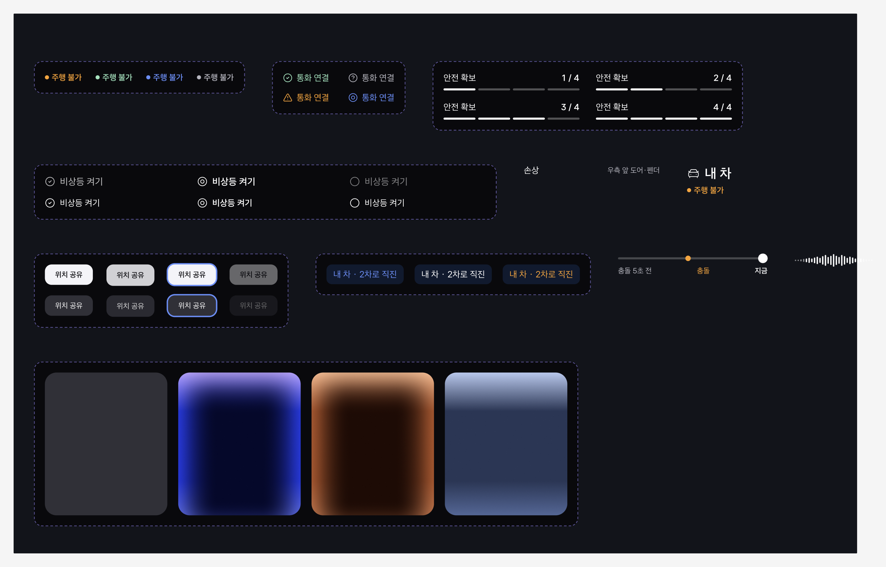
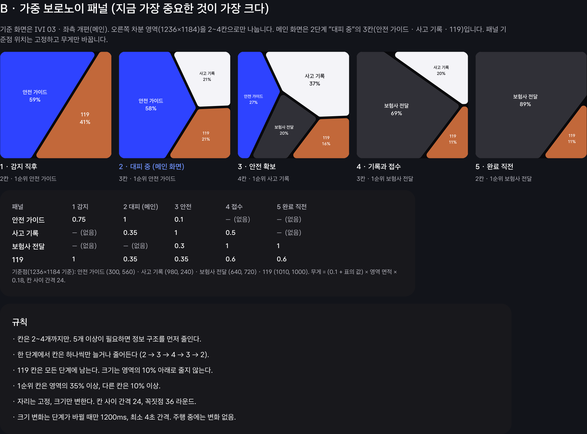

# BYONGNAM · Design System parse

Figma의 `Design System` 전체를 읽은 결과, **색·font 모음에서 component library, 사고 대응 interaction, adaptive layout 규칙까지 확장된 상태**임. Foundation과 일반 component의 binding은 상당 부분 완성되어 있지만, Voronoi와 interaction은 주로 문서·정적 예시로 정의되어 있음. 현재 frontend에 그대로 구현되어 있다는 뜻은 아님.

- 원본: [BYONGNAM · Design System](https://www.figma.com/design/nFoD9rq2LZE5jqZBQKPmGH/BYONGNAM?node-id=49-1967).
- 분석 대상: page `49:1967`의 10개 section 전체. 기준 viewport는 **2560×1440 IVI**.
- 구조화 원본: [figma-design-system.snapshot.json](./figma-design-system.snapshot.json). Variable 원값·alias chain·code syntax·style·component property·node ID·문서 text 보존.
- 생성 시각: `2026-11-11T12:47:35.006038+00:00`. 여러 read 요청의 결과이며 하나의 atomic Figma revision을 고정한 export는 아님.
- frontend 비교 기준: `feat/after-care-design-system` worktree의 현재 working tree. HEAD `866b810760f62f268e62f2ecaa49187aaf98e4d3` 이후 uncommitted 변경도 포함.
- Figma 내용·application code 변경 없음. 이 분석 문서, JSON, 확인용 screenshot만 생성.

## 1. 구성과 완성도

| 범위 | 수량 |
|---|---:|
| Section | 10 |
| Node, section root 포함 | 1,260 |
| Local variable collection / variable | 4 / 82 |
| 별도 참조한 remote variable | 4 |
| Text / effect / paint style | 13 / 3 / 0 |
| UI component family | 11 |
| Component set / 그 안의 variant | 7 / 33 |
| Standalone UI component / icon component | 4 / 15 |
| Native prototype reaction | 검사한 지원 node 1,243개에서 0 |

`COMPONENT` node 총 52개는 **33 variants + 4 standalone UI + 15 icons**의 합임. 52종의 서로 다른 UI 기능이라는 의미가 아님.

| Section | Root 포함 node 수 |
|---|---:|
| [00 · Cover](https://www.figma.com/design/nFoD9rq2LZE5jqZBQKPmGH/BYONGNAM?node-id=52-1958) | 18 |
| [01 · Color](https://www.figma.com/design/nFoD9rq2LZE5jqZBQKPmGH/BYONGNAM?node-id=52-1976) | 89 |
| [02 · Typography](https://www.figma.com/design/nFoD9rq2LZE5jqZBQKPmGH/BYONGNAM?node-id=52-2065) | 83 |
| [03 · Spacing · Radius · Effects](https://www.figma.com/design/nFoD9rq2LZE5jqZBQKPmGH/BYONGNAM?node-id=52-2148) | 73 |
| [04 · Icons](https://www.figma.com/design/nFoD9rq2LZE5jqZBQKPmGH/BYONGNAM?node-id=49-1968) | 56 |
| [05 · Components](https://www.figma.com/design/nFoD9rq2LZE5jqZBQKPmGH/BYONGNAM?node-id=49-2039) | 203 |
| [06 · Patterns](https://www.figma.com/design/nFoD9rq2LZE5jqZBQKPmGH/BYONGNAM?node-id=56-1958) | 199 |
| [07 · Rules](https://www.figma.com/design/nFoD9rq2LZE5jqZBQKPmGH/BYONGNAM?node-id=56-2174) | 26 |
| [08 · Voronoi](https://www.figma.com/design/nFoD9rq2LZE5jqZBQKPmGH/BYONGNAM?node-id=58-2094) | 256 |
| [09 · Interaction](https://www.figma.com/design/nFoD9rq2LZE5jqZBQKPmGH/BYONGNAM?node-id=59-2094) | 257 |

**잘 갖춰진 부분:** Components text 46/46, Patterns의 실제 card text 45/45가 local text style에 연결되어 있음. 실제 font·크기·line height·letter spacing도 해당 style과 일치. 두 영역의 일반 node에서 visible SOLID fill은 모두 variable binding 보유. 문서 설명용 text나 축소 도표를 제품의 typography 위반으로 집계하지 않음.

**정의와 구현을 나눠 볼 부분:** Button variant는 native component로 존재하지만 클릭에 따른 transition은 없음. Weighted Voronoi 예시는 FRAME·VECTOR로 그려진 정적 도표. Voice Wave도 static bars이며 microphone 반응을 포함한 component는 아님. 외부 prototype 3개가 연결되어 있으나 그 실행 결과는 이번 검증 범위 밖임.

## 2. 핵심 design 원칙

[Cover](https://www.figma.com/design/nFoD9rq2LZE5jqZBQKPmGH/BYONGNAM?node-id=52-1958)와 [Rules](https://www.figma.com/design/nFoD9rq2LZE5jqZBQKPmGH/BYONGNAM?node-id=56-2174)에 명시된 중심 원칙:

1. **지금 해야 할 행동 하나를 크게 표시.** Guide는 화면당 하나. Primary 수는 다른 section과 충돌하므로 아래 결정 사항에 별도 기록.
2. **사용자가 위치로 panel을 기억.** 현재 단계와 상태를 계속 표시하고, adaptive layout에서는 seed 위치를 고정한 채 크기만 변경.
3. **색에 역할 부여.** Amber는 주의·진행, Sage는 완료. Blue/violet는 Guide, copper는 119 Emergency. 상태는 글자·icon과 함께 표시.
4. **Voice 우선.** 안내는 짧은 존댓말 한 문장. 듣는 중에는 waveform 표시.
5. **Motion은 정차 중에만.** Reduced motion이면 즉시 최종 상태 표시. 주행 여부는 실제 상태와 연결해야 하는 계약.

문서에서 Pleos Connect를 따른다고 선언하지만, 이번 작업은 이 Figma의 parse임. Pleos 공식 규격과 별도 대조하거나 compliance를 인증한 결과는 아님.

## 3. Variable 구조와 정확한 값

현재 구조는 **Primitives → semantic Color alias**와 별도의 Layout·Motion collection임. 모든 component 전용 token이 세 번째 collection에 분리되어 있는 구조는 아님. Local 변수 82개 모두 WEB `codeSyntax`가 있으며, 값은 JSON에 원문으로 보존.

| Collection | Mode | 수량 | 역할 |
|---|---|---:|---|
| 차분 · Primitives | Value | 25 | 원색 |
| 차분 · Color | IVI Dark | 27 | 역할별 색 alias 및 alpha 색 |
| 차분 · Layout | Value | 18 | 간격·radius·size |
| 차분 · Motion | Value | 12 | duration·interval·ease |

Color에는 현재 **IVI Dark 한 mode만 존재**. Light theme 정의는 없음. Paint style이 0개인 것은 색이 없다는 의미가 아님. 색은 variable, gradient는 node fill의 stop binding으로 관리됨.

### 3.1 Semantic color

| Variable | 해석된 값 | Alias 대상 |
|---|---|---|
| `bg/screen` | `#09090C` | gray/950 |
| `surface/base` | `#18181C` | gray/900 |
| `surface/panel` | `#303037` | gray/800 |
| `border/subtle` | `#37373F` | gray/700 |
| `text/primary` | `#FFFFFF` | white |
| `text/secondary` | `#B6B6BF` | gray/300 |
| `text/inverse` | `#141418` | ink |
| `action/primary` | `#F4F4F8` | gray/50 |
| `action/secondary` | `#303037` | gray/800 |
| `status/warning` | `#F2A541` | amber/500 |
| `status/success` | `#A7E3BF` | sage/300 |
| `status/info` | `#6C8EF5` | blue/500 |
| `status/alert` | `#FFB39C` | coral/300 |
| `gradient/guide/start` | `#B9A6FF` | violet/300 |
| `gradient/guide/mid` | `#2E43FF` | blue/700 |
| `gradient/guide/end` | `#6D7DFF` | blue/400 |
| `gradient/guide/core` | `#05082A` | navy/core |
| `gradient/emergency/start` | `#F6BF96` | peach/300 |
| `gradient/emergency/mid` | `#C2683A` | copper/500 |
| `gradient/emergency/end` | `#DC8A5C` | copper/400 |
| `gradient/emergency/core` | `#1D0B05` | brown/core |
| `gradient/scene/start` | `#B8C7EB` | slate/200 |
| `gradient/scene/mid` | `#2B3654` | slate/700 |
| `gradient/scene/end` | `#546694` | slate/500 |
| `surface/tag` | `#121C33E0` | 직접 값 |
| `track/bg` | `#FFFFFF38` | 직접 값 |
| `overlay/scrim` | `#000000B2` | 직접 값 |

8자리 hex는 마지막 두 자리가 alpha의 8-bit 근삿값. 원래 alpha 값은 `surface/tag=.88`, `track/bg=.22`, `overlay/scrim=.70`이며 JSON의 float 원값이 정본임.

`text/primary=#FFFFFF`와 `action/primary=#F4F4F8`는 서로 다른 역할. 이름이 비슷하다고 하나로 합치면 안 됨.

### 3.2 Primitive color

| Variable | 값 | 정의 |
|---|---|---|
| `gray/950` | `#09090C` | 직접 값 |
| `gray/900` | `#18181C` | 직접 값 |
| `gray/800` | `#303037` | 직접 값 |
| `gray/700` | `#37373F` | 직접 값 |
| `gray/300` | `#B6B6BF` | 직접 값 |
| `gray/50` | `#F4F4F8` | 직접 값 |
| `white` | `#FFFFFF` | 직접 값 |
| `ink` | `#141418` | 직접 값 |
| `navy/900` | `#121C33` | 직접 값 |
| `navy/core` | `#05082A` | 직접 값 |
| `amber/500` | `#F2A541` | 직접 값 |
| `amber/600` | `#FF9F3B` | 직접 값 |
| `coral/300` | `#FFB39C` | 직접 값 |
| `sage/300` | `#A7E3BF` | 직접 값 |
| `blue/500` | `#6C8EF5` | 직접 값 |
| `violet/300` | `#B9A6FF` | 직접 값 |
| `blue/700` | `#2E43FF` | 직접 값 |
| `blue/400` | `#6D7DFF` | 직접 값 |
| `peach/300` | `#F6BF96` | 직접 값 |
| `copper/500` | `#C2683A` | 직접 값 |
| `copper/400` | `#DC8A5C` | 직접 값 |
| `brown/core` | `#1D0B05` | 직접 값 |
| `slate/200` | `#B8C7EB` | 직접 값 |
| `slate/700` | `#2B3654` | 직접 값 |
| `slate/500` | `#546694` | 직접 값 |

### 3.3 Layout

| Variable | 값(px) |
|---|---:|
| `space/4` | 4 |
| `space/8` | 8 |
| `space/12` | 12 |
| `space/14` | 14 |
| `space/16` | 16 |
| `space/20` | 20 |
| `space/24` | 24 |
| `space/32` | 32 |
| `space/40` | 40 |
| `space/48` | 48 |
| `radius/bar` | 3 |
| `radius/tag` | 16 |
| `radius/control` | 20 |
| `radius/panel` | 34 |
| `radius/full` | 999 |
| `size/icon-s` | 30 |
| `size/icon-m` | 38 |
| `size/touch` | 64 |

[Spacing 설명](https://www.figma.com/design/nFoD9rq2LZE5jqZBQKPmGH/BYONGNAM?node-id=52-2152): panel 사이 24px, 안쪽 40–48px. 기본 간격은 4의 배수에 목록용 14px를 추가한 체계. Weighted Voronoi의 36px radius와 button padding 15/30·17/30은 이 표에 없는 예외임.

`size/touch=64`는 variable 값. 실제 Button 높이는 Default 60px, Pressed 63px. Interaction의 문장상 최소 높이는 60px. 세 값을 하나의 값으로 임의 통합하지 않음.

### 3.4 Remote variable 의존성

Voronoi section의 17개 node에서 4개 remote variable 참조 확인. 모두 직접 resolve되어 **끊어진 binding은 아님**.

| Remote 이름 | 값 | Local 대응 |
|---|---|---|
| color/muted | #B6B6BF | text/secondary |
| status/amber | #F2A541 | status/warning |
| brand/calm-blue | #6C8EF5 | status/info |
| color/text | #F4F4F8 | local text/primary의 #FFFFFF와 다름 |

두 remote collection에 의존. Library 이름·소유자·update 정책까지 조사한 것은 아님. Local foundation으로 통일할지, 공유 library를 계속 참조할지 결정 필요.

## 4. Typography

Font family는 **Asta Sans**, style은 Regular 400·SemiBold 600. 최소 본문 22px는 **2560×1440 기준**이며 Micro 18px는 짧은 eyebrow용 예외임. [Typography 원본](https://www.figma.com/design/nFoD9rq2LZE5jqZBQKPmGH/BYONGNAM?node-id=52-2065).

| Style | Size(px) | Weight | Line height | Letter spacing | 설명 원문 |
|---|---:|---:|---:|---:|---|
| Display · 119 | 141 | 400 | 100% | -5.5% | 긴급 번호 전용. 화면당 하나. |
| Headline · Guide | 46 | 600 | 122% | -2% | 안전 가이드 행동 문장. 두 줄 이내. |
| Title L | 40 | 600 | 130% | 0% | 패널 제목 (내 차, 사고 내용 기록 중, 위치). |
| Title L · Call | 40 | 400 | 125% | -3.5% | 통화 상태 문장 (119 통화 연결됨). |
| Title M | 36 | 600 | 139% | 0% | 히어로 상황 요약 (충돌 감지 · 부상 있음). |
| Body L | 28 | 400 | 130% | 0% | 체크리스트 항목. |
| Body L Strong | 28 | 600 | 130% | 0% | 현재 진행 중인 체크리스트 항목. |
| Body M | 26 | 400 | 131% | 0% | 본문, 라벨, 맵 태그. |
| Body M Strong | 26 | 600 | 131% | 0% | 단계 수 (3 / 4), 강조 라벨. |
| Label | 24 | 600 | 130% | 0% | 상태 점 라벨 (주행 불가, REC 00:42). |
| Caption | 22 | 400 | 132% | 0% | 보조 값, 타임라인 라벨. |
| Caption Strong | 22 | 600 | 132% | 0% | 타임라인 현재 시점. |
| Micro | 18 | 400 | 150% | 0% | 아이브로 (긴급 통화). |

Frontend의 `Asta` family 이름과 Figma의 `Asta Sans`는 alias 차이일 수 있음. Font binary의 name table을 대조하지 않았으므로 다른 font라고 단정하지 않음.

Frontend의 17px와 Figma의 26px를 viewport 기준 없이 직접 비교해 오류라고 볼 수 없음. 다만 현재 code에는 전체 UI에 적용되는 공통 IVI scale이 없으며, 일부 status bar만 container 단위에 반응함. 2560·1920·일반 browser viewport 사이의 scale 규약을 먼저 정해야 함.

## 5. Surface와 material

[Panel component](https://www.figma.com/design/nFoD9rq2LZE5jqZBQKPmGH/BYONGNAM?node-id=50-2065)는 네 가지 style을 가짐.

| Style | 용도 | 구성 |
|---|---|---|
| dark | 일반 정보 | #303037 solid |
| guide | 현재 안전 행동 | violet/blue gradient + navy core |
| emergency | 119 긴급 통화 | peach/copper gradient + brown core |
| scene | 주변 상황 장면 | slate gradient, 별도 core 없음 |

세 gradient 모두 stop 위치가 **0%, 27%, 76%, 100%**. 중간 두 stop은 같은 mid 색. Guide/Emergency component는 360×420px, radius34이며 안쪽 core는 x30/y40, 300×420px, blur86으로 구성. 이 수치는 해당 component의 원래 크기 기준임.

| Effect style | Type | Radius(px) | 용도 |
|---|---|---:|---|
| Blur · Panel core | LAYER_BLUR | 86 | gradient 안쪽 dark core |
| Blur · Glow | LAYER_BLUR | 31 | 비상등·손상 위치의 번짐 |
| Blur · Soft | LAYER_BLUR | 12 | 장면의 부드러운 번짐 |

이 file의 82개 variable·3개 effect style에는 grain·chromatic aberration parameter가 없음. 현재 code의 grain·CA 구현이 Figma에서 폐기되었다고 볼 근거도 없음. 기존 material preset을 보존할지, 이 foundation에 추가할지 아직 별도 결정 사항임.

## 6. Component contract

Property 이름은 Figma 원문. JSON에는 Figma가 붙인 `Label#49:0` 같은 실제 key도 보존되어 있음.

| Family | Variant 축 | 노출 property |
|---|---|---|
| [Status Dot](https://www.figma.com/design/nFoD9rq2LZE5jqZBQKPmGH/BYONGNAM?node-id=49-2052) | Tone: warning / success / info / neutral | Label (TEXT) |
| [Status](https://www.figma.com/design/nFoD9rq2LZE5jqZBQKPmGH/BYONGNAM?node-id=49-2075) | State: success / unknown / warning / info | Label (TEXT) |
| [Checklist Item](https://www.figma.com/design/nFoD9rq2LZE5jqZBQKPmGH/BYONGNAM?node-id=49-2110) | Size: L / M; State: done / current / todo | Label (TEXT); Value (TEXT); Show value (BOOLEAN) |
| [Step Progress](https://www.figma.com/design/nFoD9rq2LZE5jqZBQKPmGH/BYONGNAM?node-id=49-2147) | Step: 1 / 2 / 3 / 4 | Eyebrow (TEXT) |
| [Key-Value Row](https://www.figma.com/design/nFoD9rq2LZE5jqZBQKPmGH/BYONGNAM?node-id=49-2148) | 없음 | Key (TEXT); Value (TEXT) |
| [Section Header](https://www.figma.com/design/nFoD9rq2LZE5jqZBQKPmGH/BYONGNAM?node-id=50-1987) | 없음 | Title (TEXT); Icon (INSTANCE_SWAP); Show status (BOOLEAN) |
| [Button](https://www.figma.com/design/nFoD9rq2LZE5jqZBQKPmGH/BYONGNAM?node-id=50-2012) | Type: primary / secondary; State: Default / Pressed / Focused / Disabled | Label (TEXT); Show icon (BOOLEAN); Icon (INSTANCE_SWAP) |
| [Map Tag](https://www.figma.com/design/nFoD9rq2LZE5jqZBQKPmGH/BYONGNAM?node-id=50-2019) | Tone: me / other / warning | Label (TEXT) |
| [Playback Timeline](https://www.figma.com/design/nFoD9rq2LZE5jqZBQKPmGH/BYONGNAM?node-id=50-2020) | 없음 | Start (TEXT) |
| [Voice Wave](https://www.figma.com/design/nFoD9rq2LZE5jqZBQKPmGH/BYONGNAM?node-id=50-2029) | 없음 | 없음 |
| [Panel](https://www.figma.com/design/nFoD9rq2LZE5jqZBQKPmGH/BYONGNAM?node-id=50-2065) | Style: dark / guide / emergency / scene | 없음 |

추가 해석:

- **Status Dot:** dot12px·gap8px·Label24px. 상태색 외에 label도 함께 표시.
- **Status:** icon과 label 조합. `success/unknown/warning/info`는 현재 code의 `confirmed/pending/failed/skipped`와 자동으로 일대일 대응하지 않음.
- **Checklist Item:** L/M 두 크기, `done/current/todo`. 문서의 상태 opacity는 75/100/50%. Root opacity는 L에서 이 값을 직접 사용하고, M root는 모두 1이므로 downstream 적용 시 실제 child 표현도 확인 필요.
- **Step Progress:** 안전 checklist의 **4항목** 진행 표시. Global 사고 흐름의 7단계 번호와 다른 값. `total` property는 없고 4로 고정.
- **Section Header:** Icon swap 지원. Nested Status의 Label/Tone은 root property로 노출되지 않음.
- **Button:** primary/secondary × 4 state = 8 variants. Pressed opacity85%, Focused Blue4px outline, Disabled40%. 실제 Pressed geometry는 Default보다 3px 높음.
- **Playback Timeline:** 노출 property는 시작 문구 하나. 시간·progress·playing·speed는 component property로 정의되지 않음.
- **Voice Wave:** 29개 static bar. Component box10×40px, 실제 render228×40px. `clipsContent=false`여서 보이지만 auto layout과 alignment는 실제 폭을 반영하지 못함.
- **Panel:** `Style`만 노출. Phase·weight·focus·notification state를 가진 adaptive component는 아님. 설명에서 실제 화면의 기울어진 형태는 vector로 사용하도록 지시.

Icon master 15개: `car-front`, `volume-2`, `map-pin`, `phone`, `file-text`, `circle-check`, `circle-dot`, `circle`, `circle-help`, `triangle-alert`, `house`, `navigation`, `fan`, `music`, `layout-grid`. Master는 24×24이며 사용 위치의 size token30/38과 구별 필요.

## 7. Patterns: component 조립 규칙

[Patterns](https://www.figma.com/design/nFoD9rq2LZE5jqZBQKPmGH/BYONGNAM?node-id=56-1958)는 실제 card 내부 구조를 보여 주는 조립 예시임.

| 영역 | 조립 내용 |
|---|---|
| 내 차 | Section Header + 주행 상태 + 손상·airbag·비상등 Key-Value Row |
| 현재 위치 | 도로·방향·차로 + 뒤차 접근 Status + 위치 공유 Button |
| 안전 Guide | 안전 checklist 3/4 + 큰 행동 문장 + 4개 Checklist Item |
| 사고 기록 | REC 상태 + 영상·사진·음성 목록 + 경위서 초안 |
| 긴급 통화 | 119 Display + 통화 상태 문장 + Voice Wave |
| 요청 현황 | 구호·차량 지원·보험사 각각의 Status |
| Replay | 내 차·상대 차 Map Tag + Playback Timeline |

원칙은 panel 외곽 크기가 달라도 내부 정보 순서를 유지하는 것. 예시 text는 sample이며 실제 상태나 기관 접수 사실을 증명하지 않음.

## 8. Voronoi: 세 가지 서로 다른 목적

### A. 주변 상황의 위험·안전 영역

[도표 A](https://www.figma.com/design/nFoD9rq2LZE5jqZBQKPmGH/BYONGNAM?node-id=58-2099)는 차체나 궤적을 장식하는 배경이 아니라, 실제 대상 위치를 기준점으로 삼는 공간 정보 표현.

| 기준점 | 문서상 의미 | Opacity |
|---|---|---:|
| 충돌 지점 | 가장 강한 위험 | 42% |
| 상대 차·뒤차 접근 | 위험 | 33% |
| 갓길 | 주의 | 14% |
| 내 차 | 내 위치 | 30% |
| 가드레일 밖 대피 지점 | 안전 | 42% |
| 통행 차로 | 통행 중 | 55% |

경계선은 white55%·2.5px, 차선은 구역보다 위. 대피 경로는 Sage 점선 dash4/gap12. Playback 시 기준점과 영역을 다시 계산하도록 명시.

이 정의에는 sensor 신뢰도, 영역을 위험/안전으로 판정하는 조건, 미관측 영역 표시가 없음. 도표만으로 실제 대피 경로의 안전성을 판단하는 algorithm까지 정의되었다고 해석하면 안 됨.

### B. 오른쪽 영역의 weighted panel

[도표 B](https://www.figma.com/design/nFoD9rq2LZE5jqZBQKPmGH/BYONGNAM?node-id=62-2132)의 적용 범위는 **전체 화면이 아니라 오른쪽 차분 영역1236×1184**.

| Layout phase | 칸 수 | Guide | 사고 기록 | 보험사 전달 | 119 |
|---|---:|---:|---:|---:|---:|
| 1 감지 직후 | 2 | **59%** | — | — | 41% |
| 2 대피 중, main | 3 | **58%** | 21% | — | 21% |
| 3 안전 확보 | 4 | 27% | **37%** | 20% | 16% |
| 4 기록과 접수 | 3 | — | 20% | **69%** | 11% |
| 5 완료 직전 | 2 | — | — | **89%** | 11% |

위 수치는 도표에 적힌 면적 annotation이며 이번 작업에서 polygon 면적을 다시 계산한 측정값은 아님.

| Panel | 고정 seed | Phase별 weight 입력값 1 / 2 / 3 / 4 / 5 |
|---|---|---|
| Guide | (300,560) | .75 / 1 / .1 / 없음 / 없음 |
| 사고 기록 | (980,240) | 없음 / .35 / 1 / .5 / 없음 |
| 보험사 전달 | (640,720) | 없음 / 없음 / .3 / 1 / 1 |
| 119 | (1010,1000) | 1 / .35 / .35 / .6 / .6 |

문서의 weight 변환식은 `(0.1 + 입력값) × 영역 면적 × 0.18`. **입력값을 합산해 백분율로 바꾸는 방식이 아님.** Seed 위치와 기하 계산이 면적에 관여함. 거리 metric·경계 clipping algorithm은 이 문장만으로 확정할 수 없음.

조건:

- 2–4칸만 사용하며 단계마다 한 칸씩 증가·감소.
- 119는 모든 layout phase에 남고 면적10% 이상. 다른 칸도10% 이상, 우선 칸은35% 이상.
- Seed 위치 고정, gap24px, corner36px.
- 단계가 바뀔 때만1200ms로 크기 변경. 변경 간격 최소4000ms.
- 주행 중 변화 정지. 크기 변화가 끝난 뒤 content360ms fade.

### C. 완료 후 숨 고르기

[도표 C](https://www.figma.com/design/nFoD9rq2LZE5jqZBQKPmGH/BYONGNAM?node-id=62-2229)는 완료 event마다 한 칸이 가까운 이웃으로 흡수되는 sequence.

`4칸 → 3칸 → 2칸 → 원 하나` 순서. Merge 1400ms, 마지막 원 morph1600ms. 이후 들숨2000ms·날숨2000ms 반복. 진행 중 Navy→Blue, 최종 원은 Sage. Reduced motion이면 transition 없이 최종 상태.

B의 “119를 모든 단계에 유지”와 C의 “모두 원으로 합침”을 함께 구현하려면 **모두 완료의 정의와 진행 중 통화가 있는 경우의 종료 조건**을 명시해야 함. 현재 file에는 이 boundary의 상세 계약이 없음.

## 9. Motion과 interaction

| Variable | 값 | 용도 원문 |
|---|---|---|
| `motion/duration/fast` | `160` | 누름 피드백 (ms) |
| `motion/duration/state` | `240` | 체크·상태 전환 (ms) |
| `motion/duration/layout` | `360` | 패널 안 내용 전환 (ms) |
| `motion/duration/panel-weight` | `1200` | 가중 보로노이 패널 크기 변화 (ms) |
| `motion/duration/merge` | `1400` | 숨 고르기 · 칸 합쳐짐 1회 (ms) |
| `motion/duration/morph` | `1600` | 숨 고르기 · 원으로 모핑 (ms) |
| `motion/duration/breath-in` | `2000` | 들숨 (ms) |
| `motion/duration/breath-out` | `2000` | 날숨 (ms) |
| `motion/interval/min-panel-change` | `4000` | 패널 크기 변화 최소 간격 (ms) |
| `motion/ease/standard` | `cubic-bezier(.22,1,.36,1)` | 기본 전환 |
| `motion/ease/breath` | `cubic-bezier(.65,0,.35,1)` | 호흡 · 패널 크기 (in-out) |
| `motion/ease/press` | `cubic-bezier(.2,0,0,1)` | 누름 |

### Global 흐름: 7단계

[Interaction flow](https://www.figma.com/design/nFoD9rq2LZE5jqZBQKPmGH/BYONGNAM?node-id=59-2172)에 적힌 조건:

| 단계 | 문서에 적힌 조건 | 강조 대상 |
|---|---|---|
| 1 감지 | 충격 감지 | 119·안전 |
| 2 119 연결 | 응답 없으면10초 후 자동 | 119 |
| 3 대피 안내 | 음성 “네” 또는 button | 안전 Guide·위치 |
| 4 안전 확보 | checklist4/4 | 사고 기록 |
| 5 기록 | 사진·음성·영상 저장 | 사고 기록 |
| 6 접수 | 경위서 확인 후 전송 | 보험사 전달 |
| 7 완료 | 전송 완료 | 숨 고르기 원 |

**Global7단계, weighted layout5단계, 안전 checklist4항목은 서로 다른 개념.** 같은 index로 연결하면 안 됨. 특히 119 연결 시119가 커진다는 flow와 B의 weight table 사이에 직접 대응 row가 없음. “위치”도 B의 seed 목록에는 없음.

2단계 문구는 자동 연결을 단순화한 설명으로 보임. Runtime에서는 10초 경과와 실제 통화 연결 event를 구분하는 계약 필요. 통화 연결·구조 접수·보험사 전송 완료를 하나의 success로 묶는 정의는 없음.

### 입력·focus·replay

- Voice: 예/아니오로 답할 수 있는 질문, “네 / 괜찮아요 / 도와줘” 상시 인식, 듣는 중 Voice Wave.
- Touch: 높이60px 이상·사이 간격24px 이상. 숨은 long press·swipe 없음.
- Focus: steering dial로 panel 이동, Blue4px outline. 우선순위 순으로 이동하며 panel 제목을 음성으로 읽음.
- Driving: speed>0이면 panel·breathing motion 정지, text 입력·기록 편집 잠금,119·voice만 허용. 정차 후360ms 복귀.
- Replay: scrub 시 장면·영역 재계산. 충돌 지점 근처에서 놓으면 snap. 기본 재생2.5×, 끝은 “지금”. 주행 중은 “지금”으로 고정.

이 항목은 **문서로 정의된 behavior**. Design System 내부의 native prototype reaction은0개이며, 실행 가능한 제품 구현 여부는 별도임.

## 10. Figma 내부에서 먼저 정리할 부분

| 항목 | 관찰한 사실 | 필요한 결정 또는 정리 |
|---|---|---|
| Primary 수 | Cover52:1966·Rules56:2194는 화면당1개. Interaction59:2249는1–2개 | 화면당 원칙과 emergency 예외 유무 확정 |
| Radius 범위 | 기본 Panel34, weighted cell36. 36 token 없음 | 다른 scope의 의도적 값인지 명시하고 이름 분리 여부 결정 |
| Touch 크기 | token64, component60/63, 문서minimum60 | 시각 크기와 hit area의 관계 또는 실제 size 정본 확정 |
| Pressed geometry | 높이60→63, padding15→17 | opacity 변화만 의도했는지 확인. 불필요한 layout shift 가능 |
| Spacing 예외 | 4의 배수+14 규칙에 padding15/17/30 사용 | optical 예외인지, 정렬 전 측정 오류인지 구별 |
| Voice Wave | box10px, render228px | container가 실제 폭을 반영하도록 geometry 정리 필요 |
| Stage mapping | Global7 / layout5 / checklist4, 위치 seed 없음 | Event별 layout phase와 남는 panel을 표로 연결 |
| 색 binding | A 대피4nodes는 #7FB69E raw, C 중간9panels도 raw | Sage 정본 #A7E3BF와 의도적으로 다른지, transition 색 token인지 결정 |
| Remote 변수 | 2개 library collection의4alias 정상 resolve | local 체계와 중복 유지·통합 정책 결정 |
| Material notification | gradient 역할은 정의. 이전 gray→색 dimming→pulse와 grain·CA parameter는 없음 | 기존 제품 합의와 새 Figma의 적용 관계 명시 |
| 완료 boundary | 119항상 유지 조건과 최종 원 통합 | 통화·기관 응답이 남아 있을 때 종료 조건 정의 |

Radius34/36은 반드시 오류라고 단정할 수 없음. 기본 panel과 weighted cell의 scope 차이일 수 있으므로, Primary 개수의 직접 충돌과 구분함.

## 11. 현재 frontend와의 대조

Source는 `prototype/web` 기준. 아래는 구현 범위 조사 결과이며 실제 IVI 실기 검증 결과가 아님.

| 항목 | Figma | 현재 frontend | 판단 |
|---|---|---|---|
| Guide/Emergency | Guide blue/violet,119 copper | [surfaces.ts](../../prototype/web/src/design-system/surfaces.ts)의 call blue·safety copper | **색 역할이 반대.** 단순 색값 교체보다 semantic 연결부터 정리 |
| Neutral/status | bg/base/panel,success/alert와 분리된 warning/info | [tokens.css](../../prototype/web/src/design-system/tokens.css)의 기본 neutral·success·attention 상당수 일치. pending #E8D797,info 없음 | 이미 맞는 부분 보존. pending/warning/info mapping 필요 |
| Text/action | primary text #fff, primary action #F4F4F8 | 일반 text #F4F4F8 | 별도 역할을 code에서도 분리할지 결정 |
| Type hierarchy | Guide600/1.22/−.02em, panel title600 | [response-content.css](../../prototype/web/src/components/ui/response-content.css) Guide400/1.35/−.03em; [after-care.css](../../prototype/web/src/components/ui/after-care.css) heading400 | Size와 무관한 hierarchy 차이.119의400/1/−.055em은 일치 |
| Geometry | Button60/r20,Panelr34,weightedr36/gap24 | touch48/r16,cardr28,splitgap16 | Viewport scale 계약 이후 비교. 일괄 숫자 교체는 부적절 |
| Button state | Pressed85%,focusblue4,disabled40% | pressedscale.985,focuslavender3,disabled50% | Scale과 무관한 state 차이 |
| Weighted layout | 고정seed+weight,2–4cells,area guard | [split-geometry.ts](../../prototype/web/src/design-system/split-geometry.ts)의 measured slot 기반 고정3cell | 현재 engine이 새 weighted definition을 구현하는 것은 아님 |
| Motion | panel1200,mininterval4000,merge1400,morph1600,breath2+2초 | [interaction-study-model.ts](../../prototype/web/src/design-system/interaction-study-model.ts)의 notification pulse. 전역 fast/state/layout160/240/360만 있음 | Notification과 완료 breathing은 별도 기능 |
| Reusable component | 11UI families | CareAction/Status/Surface/Heading/Spectrum 등 존재. checklist/progress/maptag/timeline/KV는 local markup | Foundation 재사용 가능. Figma 이름으로 중복 component부터 만들 필요 없음 |
| Voice | voice commands+wave+안내 | [VoiceRecordPanel.tsx](../../prototype/web/src/journey/VoiceRecordPanel.tsx)의 녹음·실제 음량 wave, [GuidanceControl.tsx](../../prototype/web/src/audio/GuidanceControl.tsx)의 안내 재생 존재 | 상시3구문 dispatcher는 조사 범위에서 미구현 |
| Driving lock | speed>0에 따른 입력·motion·replay 제한 | [case.ts](../../prototype/web/src/journey/case.ts) JourneyCase에 speed/driving state 없음 | 실제 driving 상태와 UI 연결 필요 |
| Surroundings | 위험/안전 polygon+대피 경로 | [SurroundingsStudy.tsx](../../prototype/web/src/design-system/SurroundingsStudy.tsx)의 차량·궤적·접촉 표시 | 새로운 spatial layer. 기존 trajectory/contact를 버릴 근거 없음 |
| Replay | 2.5×,collision snap,driving gate | 1× 기본,0.5/1/2×선택,explicit collision jump,끝에서 정지 | Snap·속도 정책·주행 gate 추가 결정 필요 |

현재 scene study는 DEV-only 진입 경로이며 fixture를 사용. 제품 Journey와 완전히 연결된 전역 기능으로 간주하지 않음. 기존 `[record, review, follow-up]` 계열 흐름을 새7단계로 대체할 때는 단어만 바꾸는 방식보다 event와 상태 관계부터 검토 필요.

## 12. 구현 전에 권장하는 정리 순서

이번 작업에서는 아래 변경을 실행하지 않음. 분석 결과에 따른 순서 제안임.

1. **규칙 충돌·미정의 계약 정리:** Primary 수, scale, radius scope, touch hit area, stage mapping, 완료 boundary.
2. **Source of truth 연결:** Color alias·type hierarchy·component state를 현재 token과 mapping. 이미 일치하는 neutral·success 및119 type 속성 보존.
3. **작은 Figma geometry 정리:** Voice Wave bounds, Pressed 크기, raw/remote color binding의 의도.
4. **상태와 layout 연결:** 실제 event를 기준으로 global stage·layout phase·안전 checklist 구분. Driving lock·voice·전송 결과 계약 포함.
5. **동작 검증:** 한 화면에서 weighted layout과 focus·긴 문장·음성·reduced motion을 확인한 뒤 전역 적용. 마지막에 E2E 영상 제작.

## 13. 검증 범위와 한계

- JSON parse 성공,1260 node ID 중복 없음,10section count 일치.
- Local82variables 전부 추출. 참조 alias 전부 resolve,cycle0,미해결 참조0.
- Component property definitions11개 root 확인. Child ID 참조 누락 없음.
-13text·3effect·0paint style count 검증. Weighted 도표의 표기 면적 합100%,최소10%·우선35% 조건 확인.
- Component library와 weighted diagram screenshot을 직접 확인. Native reaction 지원 node1243개에서0개 확인.
- Full vector path·원본 image asset·version history·작성자별 변경 내역은 추출하지 않음. JSON은 재현 가능한 `.fig` backup이 아닌 **design metadata snapshot**.
- IA 등 다른 page 내용, 연결된 외부 prototype 실행, frontend runtime·실제 IVI 사용성·실제 차량/기관 연동은 이번 검증 범위 밖.

Frontend code·Figma·Git history 변경 없음. 실행 여부를 검증하지 않은 interaction은 문서상 정의로 구분함.
