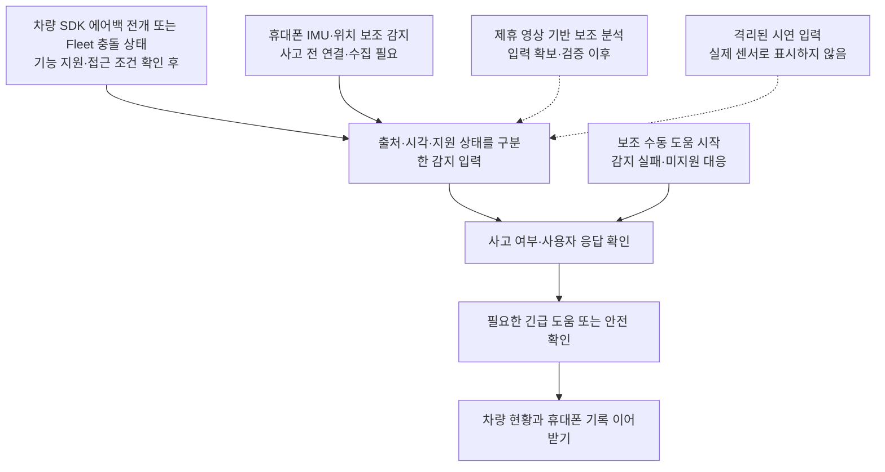

# 충돌 감지 지원 확인과 개발 계획

2026-11-14 기준 공식 Pleos·Android 문서와 현재 앱의 감지 입력을 대조했다. 사용자는 **충돌 자동 감지를 필수로 유지하고, 직접 신호가 제한되면 비전·다른 센서 활용 계획을 마련할 것**을 요구했다. 이 문서는 조사와 제안이며 실제 센서 수집·충돌 검출·Fleet 연동·에뮬레이터 실행을 완료했다는 기록이 아니다.

## 1. 결론

- **Vehicle SDK에도 실제 에어백 전개 조회·변경 알림 API가 있다.** 공개된 `Vehicle:2.3.2` AAR의 `Safety`와 `SeatAirbagDeployedListener`를 `javap`로 확인했다. 경고등 전용 API가 아니다. 따라서 공개 SDK로 사고 관련 자동 신호를 받을 경로가 없다는 전제는 잘못이다. 단, 전개하지 않은 경미 사고까지 검출한다는 뜻은 아니다. [전개 조회][airbag-query], [전개 콜백][airbag-callback], [SDK AAR][vehicle-aar]
- **공식 충돌 상태 신호는 존재한다.** Fleet API Webhook의 차량 이벤트에 `items[].data.Emergency.Crash`가 `ValueObject<String>`이고 값은 `CRASH` / `UNCRASH`로 공개돼 있다. 같은 표의 `WarningLamp.Airbag` 경고등과 별개다. [차량 이벤트][fleet-event]
- **Fleet API와 차량 내부의 Vehicle SDK는 다른 접근 경로다.** Fleet은 계약 후 endpoint 제공, 사용 신청·승인, Client ID·Secret·Project ID, Webhook 등록이 필요하다. 문서 공개만으로 현재 참가 앱·모든 차량에서 즉시 사용할 수 있다는 뜻은 아니다. [시작하기][fleet-start], [Webhook][fleet-webhook]
- 충돌 신호를 찾지 못했다는 이유로 수동 시작 전용 앱으로 바꾸지 않는다. 공식 차량 신호를 우선 검토하고, 미지원 환경의 휴대폰 센서 기반 **충돌 의심** 감지와 비전 보조를 별도 개발 경로로 둔다.
- **현재 앱에는 실제 감지가 연결되지 않았다.** `JourneyStudy.tsx:177-180`의 `우측 전방`, `0.4 G`, `오후 9:12`는 `source: 'fixture'`로 주입된다. 현재 Android 앱의 dependency에는 Compose만 있고 Pleos SDK가 없다. 화면의 충돌 감지 표기나 과거 회귀 검사 통과는 실제 감지 증거가 아니다.

## 2. 입력별 근거와 제약

| 입력 | 확인한 사실 | 제품 적용 조건 |
| --- | --- | --- |
| Vehicle SDK 에어백 전개 | 좌석별 지원 조회 `checkAirbagDeployedCapabilities`, 전개 조회 `hasSeatAirbagBeenDeployed`, 구독 `registerSeatAirbagDeployed`와 Boolean 변경 콜백을 AAR에서 확인 | `CAR_SAFETY` 권한·capability·지원 좌석·실제 Service 수신 검수 필요. 미전개를 사고 없음으로, 전개를 부상·심각도 확정으로 해석하지 않음 |
| Fleet 충돌 상태 | `Emergency.Crash`와 발생 시각을 가진 `ValueObject`가 공개됨. 데이터는 차량에서 수신된 경우에만 포함되는 선택값 | 계약·승인, 대상 차량·단말 등록과 실제 제공 여부, 인증된 수신 경로, 지연·단절 검증 필요. 값 누락을 `UNCRASH`로 바꾸지 않음 |
| Vehicle SDK 차량 상태 | Brake, Light, Safety 등 도메인과 capability 조회·현재값·변경 알림 구조 제공 | 차량·기능별 지원 및 읽기 권한을 확인. 브레이크·비상등·경고등을 충돌 확정 신호로 취급하지 않음 |
| 차량 원시 IMU·카메라·블랙박스 | 이번에 확인한 공개 안내만으로 일반 앱의 입력 가용성을 확정할 수 없음 | 물리 센서 직접 접근 금지. SDK 미제공 특수 property는 사전 기술 검토 필요. 일반 Android API 존재를 Pleos 접근 허가로 간주하지 않음 |
| Android 휴대폰 IMU | `SensorManager`, `TYPE_ACCELEROMETER`, `TYPE_LINEAR_ACCELERATION`, `TYPE_GYROSCOPE`로 기기가 제공하는 센서값 수집 가능 | 별도 폰 실행부, 사고 전 연결·수집, 센서 존재·범위·권한·거치 상태 확인. 사고 검출 성능은 별도 검증 |
| 휴대폰 위치·속도 | Android 위치 입력을 보조 신호로 사용할 수 있음 | 위치 권한과 데이터 시각·정확도·누락을 처리. GPS 속도 변화만으로 충돌 확정 금지 |
| Vehicle Data API 운행 이력 | 종방향 가속도·yaw 이력 공개. 문서상 현재 유럽 제공, 사업자 기초 데이터는 동의 후 24시간이 지난 뒤부터 조회 | 기간 조회형 운행 데이터를 즉시 로컬 충돌 트리거와 혼동하지 않음. 동의 후 이용 가능 시점을 각 샘플의 전송 지연으로 해석하지 않음 |
| 비전 | AAOS Camera2는 플랫폼 기능으로 존재하지만 OEM의 camera service 활성화·하드웨어 제공이 전제 | Pleos 차량 영상의 실제 접근·권한·정책 또는 제휴 블랙박스 입력을 먼저 확보. 영상 재생 가능과 실시간 카메라 접근 가능은 별개 |

차량 상태·가용성은 [Vehicle SDK 소개][vehicle-intro], [호환성][availability], [하드웨어 정책][hardware]를 따른다. 폰 센서는 [Android 동작 센서][motion], [센서 개요][sensors]를 따른다. 운행 이력은 [Vehicle Data API][data-intro], [운행 데이터][operation-data], 카메라는 [AAOS 카메라][camera], [Camera Service][acs]를 근거로 한다.

### SDK 실물 확인

- 공식 Maven 좌표: `ai.pleos.playground:Vehicle:2.3.2`. AAR SHA-256: `e11fdfe498cad3ecc0d5a2a6992b0c4a4d135195f1455018127bc069fd5ef937`.
- `classes.jar`의 `Safety.checkAirbagDeployedCapabilities`는 `CapabilityConfig`와 `List<SeatArea>`를 성공 콜백으로 전달한다. `hasSeatAirbagBeenDeployed`는 `SeatArea`를 받아 Boolean 결과를 전달하며, `registerSeatAirbagDeployed`는 같은 좌석과 `SeatAirbagDeployedListener`를 받는다. 구독 해제 API도 존재한다.
- 리스너에는 `onSeatAirbagDeployUpdated(java.lang.Boolean)`가 있다. `getTelltalesInfo`·`registerTelltales`는 별도 경고등 API다. 확인한 capability·전개 조회·전개 구독 메서드에는 `@RequiresPermission("pleos.car.permission.CAR_SAFETY")`가 붙어 있다. [권한 안내][vehicle-permission]
- `Vehicle.getGear()`와 `Gear.getCurrentGearSelectionState`·`registerGearSelection`도 AAR에 존재한다. 문서 도메인 요약이나 검색 라우트에 항목이 안 보인다는 이유로 SDK 전체에 없다고 단정하지 않는다. 실제 사용은 공개 명세·권한·실행 지원을 함께 확인한다.
- 공식 소개는 Service `2.3.21`, Sample App 안내는 `2.3.22`를 기준으로 한다. 실제 설치된 버전과 각 기능의 지원 결과를 별도로 기록해야 한다. **이번 확인은 배포 바이너리의 API·권한 확인이며, 전용 에뮬레이터에서의 동작 검증은 아니다.** [소개][vehicle-intro], [Sample App][sample]

## 3. 권장 제품 구조

다음은 조사에 근거한 제안이며, 폰 상시 감지의 포함 여부와 구체적인 진입 UX는 사용자 결정으로 확정한다.

### A. 공식 차량 신호 우선

1. 차량 SDK에서는 `CAR_SAFETY` 권한과 좌석별 전개 capability를 확인하고 지원 좌석의 조회·변경 콜백을 연결한다. 미지원·오류·수신 없음은 정상 안전 상태와 구분한다.
2. Fleet은 별도로 계약·접근 조건, 공모전 이용 가능 여부, 대상 차량·단말의 실제 제공 여부를 확인한다. 확인 전에는 연결을 약속하거나 성공을 표시하지 않는다.
3. 수신 데이터에는 제공 출처, 대상 차량, 사건 발생 시각과 수신 시각을 구분한다. SDK 전개 콜백의 Boolean만으로 사고 발생 시각을 알 수 없으므로 앱 수신 시각을 사고 시각으로 꾸미지 않는다. 초기 조회에서 이미 전개된 상태를 읽었다고 매번 새 사고를 만들지 않는다.
4. 같은 이벤트의 재전달과 서로 다른 추가 사고를 구분한다. 오래된 데이터로 새로운 사고를 자동 확정하지 않는다.
5. 에어백 전개나 `CRASH`만으로 부상·심각도·충격 방향·G값을 만들어내지 않는다. `UNCRASH` 수신이나 에어백 미전개도 기존 사고 기록 종료나 사용자 안전 확인을 대신하지 않는다.
6. 신호 미지원·권한 거절·오프라인은 **감지 이용 불가**이며 **사고 없음**이 아니다. 사용자가 직접 도움을 시작할 경로는 감지의 대체가 아니라 실패 대응으로 유지한다.

### B. 휴대폰 센서 보조 감지

1. 지원 센서 목록·측정 범위를 확인하고, 중력 성분·기기 좌표·거치 방향을 고려해 가속도·회전 시계열을 수집한다. 지원하지 않는 센서값을 고정값으로 채우지 않는다.
2. 충격 파형, 회전 변화, 유효한 위치·속도 정보를 시간대별로 대조하는 후보 검출기를 검증한다. 근거 없는 G값 하나를 충돌 기준으로 확정하지 않는다. 출력은 **충돌 의심과 확인 요청**이다.
3. Android 9 이상에서는 백그라운드 앱이 연속 센서 이벤트를 받지 못하므로, 화면 밖에서도 감지하려면 적절한 foreground service·알림·권한과 최신 Android 정책을 반영해야 한다. 화면이 켜진 수집 시연과 상시 동작 완료를 구분한다. [센서 개요][sensors]
4. **사고 후 QR을 열면 과거 충격은 측정할 수 없다.** 이 방식을 핵심 감지로 쓰려면 운행 전에 폰 실행·거치·동의·연결하는 사용자 흐름이 추가된다. 현재 합의한 사고 후 기록 이어받기만으로 대체되지 않는다.
5. Pixel은 위치·동작 센서·주변 소리를 조합하는 제품 사례지만, 모든 충돌 감지와 무오탐을 보장하지 않는다. 그 기능을 우리 앱이 호출할 수 있는 공개 API나 국내 가용성의 증거로 사용하지 않는다. 마이크 수집을 이번 제안의 필수 입력으로 추가하지 않는다. [Pixel 공식 안내][pixel]

### C. 비전 보조 개발

1. 먼저 합법적으로 사용할 전방 영상 입력을 확보한다. OEM이 공개·승인한 카메라 또는 제휴 블랙박스 스트림, 사용자 제공 파일은 서로 다른 입력이다. 사고 후 파일 분석은 실시간 자동 감지가 아니다.
2. 입력 확보 후 충돌 전후 시간 구간·상대 차량 움직임 등을 분석하는 후보 모델을 비교하고 IMU·차량 신호와 시간대별로 대조한다. 입력이 없는 상태에서 모델명·정확도·성공을 먼저 확정하지 않는다.
3. 야간·역광·우천·가림·카메라 시야 밖의 측후방 충격을 포함해 오탐·미탐을 평가한다. 비전 단독 결과로 사고·과실·부상을 확정하지 않는다.
4. 영상·학습 데이터의 이용 권리, 번호판·얼굴·위치 처리와 보존 범위를 확인한다. 공개 연구 코드의 라이선스가 수집 영상 권리까지 보장하지는 않는다.
5. 카메라 프라이버시 토글을 우회하지 않는다. AAOS의 privileged camera allowlist나 EVS를 일반 앱의 기본 권한으로 전제하지 않는다. [카메라][camera], [Camera Service][acs]

## 4. 이번 구현·출품 검증 경계

[공모전 공지 008][contest]은 공개 SDK·API 범위에서 개발하고 미지원 기능은 향후 계획으로 표시하라고 안내한다. 공개된 Fleet 문서가 존재한다는 사실은 Fleet 계약·공모전 접근 권한이 제공됐다는 뜻이 아니다. 검증 단계는 다음처럼 분리한다.

| 검증 단계 | 직접 확인할 것 | 주장할 수 없는 것 |
| --- | --- | --- |
| 공식 Pleos SDK 통신 | 전용 에뮬레이터에서 capability, 조회·callback 결과, 지원 불가·오류 처리 | 일반 AVD나 dependency 추가만으로 Pleos 실제 연동 완료 |
| 충돌 입력 후 서비스 동작 | 명시적 시연 입력을 제품 입력과 분리하고 감지 확인·위험 분기·기록 보류·실제 폰 이어받기까지 완주 | 이벤트 재생만으로 충돌 센서·Fleet 실차 연동 완료 |
| 실제 폰 센서 수집을 포함하는 경우 | 실기기 센서값·시각, 권한·수집 중단·재개, 거치 변화, 화면 꺼짐 상태의 실제 결과 | 폰 흔들기나 가상 파형으로 실제 충돌 검출 정확도 입증 |
| 검출기 성능 | 적법한 라벨 데이터와 분리된 평가 자료로 오탐·미탐·지연을 측정 | 평가 자료 없이 임계치·정확도·안전성을 확정 |
| 실제 Fleet 연계 | 승인된 endpoint와 차량에서 충돌 상태·발생 시각을 수신한 증거 | 직접 만든 HTTP 요청을 실제 Fleet 수신이라고 표시 |

공식 Virtual Console 안내에는 기어·브레이크·비상등·Safety 경고등 등의 카드가 있지만 충돌·IMU 파형 전용 카드는 제시되지 않았다. 콘솔의 경고등 조작을 실사고 재현으로 바꾸어 말하지 않는다. 실제 실행 환경과 SDK 수신 결과는 아직 검수하지 않았다. [Virtual Console][console]

검출기 검증에는 정상 주행, 급제동, 방지턱, 휴대폰 집기·낙하, 센서 누락, 지연·재전달, 추가 충격과 중단 후 복귀를 포함한다. 실제 차량 충돌이나 위험한 주행을 만들어 시험하지 않는다. 센서·비전의 미탐 가능성을 사용자 도움 경로와 함께 설명한다.

**다음 주요 결정:** 공식 차량 신호 우선이라는 제품 목표를 유지하되, 이번 구현에 운행 전 연결을 전제로 한 Android 폰 센서 실측·의심 감지까지 포함할지 확정한다. 감지 기능 삭제 여부를 다시 묻는 질문이 아니다.

## 출처

[fleet-event]: https://document.pleos.ai/en/api-reference/fleet-api/fleet-api-webhook/webhook-event-type/vehicle-event
[fleet-start]: https://document.pleos.ai/api-reference/fleet-api/getting-started
[fleet-webhook]: https://document.pleos.ai/api-reference/fleet-api/fleet-api-webhook/webhook-overview
[vehicle-intro]: https://document.pleos.ai/docs/pleos-only/connect-sdk-pleos/Vehicle/intro
[availability]: https://document.pleos.ai/docs/pleos-only/vehicle-app-planning-guide/api-compatibility-availability
[hardware]: https://document.pleos.ai/en/docs/pleos-only/vehicle-app-planning-guide/platform-api-architecture
[motion]: https://developer.android.com/develop/sensors-and-location/sensors/sensors_motion
[sensors]: https://developer.android.com/develop/sensors-and-location/sensors/sensors_overview
[data-intro]: https://document.pleos.ai/api-reference/vehicle-data-api/intro
[operation-data]: https://document.pleos.ai/api-reference/vehicle-data-api/vehicle-data-api/common/get-vehicle-operation-data
[camera]: https://source.android.com/docs/automotive/camera
[acs]: https://source.android.com/docs/automotive/camera/acs
[pixel]: https://support.google.com/pixelphone/answer/7055029
[contest]: https://appdevchallenge.auto-hmg.io/notice/c0a1a000-2026-4923-8000-000000000008
[console]: https://document.pleos.ai/docs/pleos-only/app-test-guide/virtual-console-guide
[airbag-query]: https://document.pleos.ai/docs/pleos-only/connect-sdk-pleos/Vehicle/vehicle/ai.pleos.playground.vehicle.api/safety/has-seat-airbag-been-deployed
[airbag-callback]: https://document.pleos.ai/docs/pleos-only/connect-sdk-pleos/Vehicle/vehicle/ai.pleos.playground.vehicle.listener/seat-airbag-deployed-listener/on-seat-airbag-deploy-updated
[vehicle-aar]: https://nexus-playground.pleos.ai/repository/maven-releases/ai/pleos/playground/Vehicle/2.3.2/Vehicle-2.3.2.aar
[vehicle-permission]: https://document.pleos.ai/docs/pleos-only/connect-sdk-pleos/Vehicle/vehicle-permission
[sample]: https://document.pleos.ai/docs/pleos-only/tutorial/vehicle-sdk-sample-app
