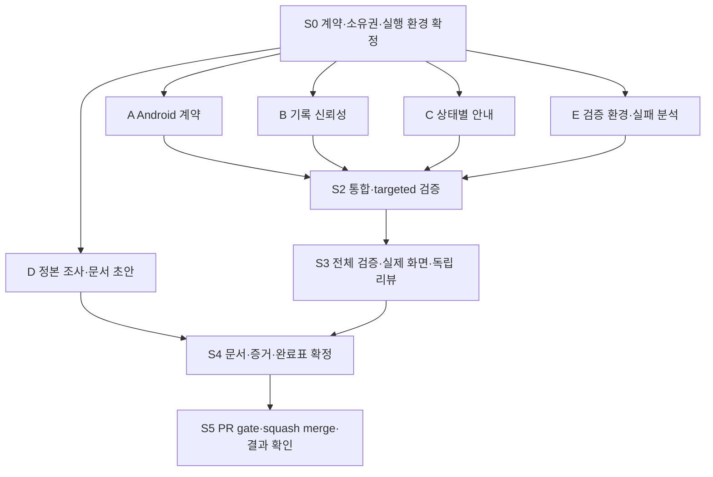

# Contract Reliability Repair — 병렬 구현·검증·머지 계획

작성일: 2026-11-12. 상태: **2026-11-13 사용자 query에 따라 실행 중**. 아래 checkbox는 실제 실행 증거에 따라 갱신한다. 계획 작성·worker 구현 완료를 검사 통과나 merge 완료로 표시하지 않는다.

**Goal:** Android 공유 계약, 기록 신뢰성, 상태별 안내, 검증 재현성, 정본 승계를 [상세 스펙](../specs/2026-11-12-contract-reliability-repair-design.md)의 32개 요구에 맞춰 복구한다.

**실행 권한:** 이 문서는 설계 산출물이다. 실제 구현·도구 설치·유료 음성 생성·push·merge 권한은 사용자가 실행하는 [goal query](2026-11-12-contract-reliability-repair-goal-query.md)에 따른다. 과거 문서의 local-only 또는 merge 허용 문구를 새 실행 권한으로 재사용하지 않는다.

**기술 선택:** 기존 React·TypeScript·Kotlin·Compose·IndexedDB·Playwright·Gradle을 사용한다. 새 runtime dependency·범용 command framework·멀티플랫폼 엔진은 추가하지 않는다.

## 1. 실행 단위와 DAG

통합 담당은 D 문서 작업도 맡는다. A/B/C/E 네 worker는 병렬로 조사·구현하고, 모든 실제 검사는 통합 후 단일 검증 담당이 실행한다.



E의 maximum-duration 분석이 B 소스 변경을 요구하는 것은 부분 의존성이다. E는 관찰·원인·필요 계약을 B에 전달하고 자기 소유의 test/진단 작업을 계속한다. E가 B 파일을 직접 편집하거나 B 완료 때까지 전체 트랙을 놀리지 않는다.

## 2. 파일 소유권과 공통 계약

Frontend 표의 `src/`, `tests/`, `scripts/`는 `prototype/web/` 기준이다.

| 소유자 | 편집 허용 범위 | 읽기 전용·금지 |
|---|---|---|
| A | `prototype/android/app/src/main/java/com/example/accidentpoc/`의 세션·파서·UI, `androidTest/`와 필요한 native test source, Android build/manifest의 직접 필요한 변경 | 공유 `scenarios.json`·`glyphs.json` 의미 변경 금지. Web 수정 금지. Android README는 D 소유 |
| B | `src/journey/{JourneyStudy,useJourneyCase,VoiceRecordPanel,ReportPanel,JourneyRecovery,JourneyReviewPanel,case,case-validation}.ts(x)`, 원인이 확정돼 필요한 `voice-capture.ts`, 직접 필요한 지역 CSS; `src/design-system/DesignSystemCatalog.tsx`의 ReportPanel 결과·reload 계약 호출부; 새 `tests/journey-record-reliability.spec.ts`, 기존 `journey-save-recovery`, `journey-review-fixes`, `journey-report`, `journey-domain` 검사 | `tests/journey-voice.spec.ts`는 E 소유. 안내 MP3·Emergency·공용 geometry 수정 금지 |
| C | `src/emergency/{EmergencyStudy,EmergencySurface,WorkflowPanel}.tsx`, 새 `guidance.ts`, 새 `src/audio/emergency-guidance.json`, `src/audio/{manifest,assets}.ts/json`의 직접 필요한 변경, audio hook·generator·검증 script·해당 asset/sidecar, `src/design-system/ResponseLayoutPreview.tsx`의 guidance resolver 연결, 기존 `guidance-audio`, `emergency-complete` 검사와 새 `tests/emergency-guidance-state.spec.ts` | 사용자 녹음 패널·Journey aggregate·공유 시나리오의 상태 전이 변경 금지 |
| E | `tests/stable-voronoi-motion.spec.ts`, `tests/journey-voice.spec.ts`, 필요한 recorder test helper·Playwright 출력 설정, `evidence/contract-reliability-repair/` 수집 계약 | 제품 소스 원인은 B/C/A 담당에게 전달. 프로덕션 코드 수정·worker별 검사 실행 금지 |
| 통합 담당 / D | 이 계획·스펙·goal query, root/Web/Android README, `SOURCES.md`, 관련 `specs/after-care-system/`·음성/시각 문서, 누락 visual-contract, 관련 과거 plan/result의 명시적 정정, 미래 repair result 문서 | source ownership을 임의 침범하지 않는다. 사용자 무관 변경·원본 board·archive는 stage하지 않음 |

추가 파일이 필요하면 편집 전에 소유권 표를 갱신하고 한 owner만 배정한다. 일반 코드 참조·export 변경은 실행 환경에서 LSP 가용 여부를 확인해 가능한 references/code action을 사용한다. 새 prop/API는 제품·catalog·harness 호출부를 모두 이관하며 임시 shim·과거 alias를 남기지 않는다.

### S0에서 고정할 인터페이스

- **A:** 세션은 scene의 projection이 아니라 누적 requests/facts·승인·중단 상태의 정본. Web SC05 전이와 같은 의미를 갖는다. `rememberSaveable`에 전체 상태를 복원.
- **B URL:** 어떤 경로든 현재 case의 첫 durable 성공을 공통 성공 계약으로 소비. 오래된 case 완료는 URL 갱신 금지.
- **B editor:** durable statement identity/revision과 local dirty draft를 구별. 명시적 reload에는 recovery 보존과 최신 표시를 함께 제공.
- **B report:** 공통 100문장 limit와 명시적 성공/거절/저장 실패를 전달. commit 결과 전에 draft 종료 금지.
- **C:** Session·scene·persistence → 정확한 원고·context key의 순수 선택. generator가 runtime variant 원고도 수집.
- **E:** 제품·테스트·설정·자산 hash와 test outputPath → 영구 증거의 일대일 경로. retry/timeout 완화 금지.
- **D:** 구현 관찰·설계 근거·사용자 승인을 다른 상태로 기록. repair 완료와 전역 goal 완료를 분리.

## 3. S0 — 환경·권한·기준 고정

**Owner:** 통합 담당. 제품 수정 전에 완료한다.

- [ ] 실제 `AGENTS.md` 등 프로젝트 지침과 작업 트리·현재 branch·remote·사용자 변경을 확인한다. 불필요한 과거 세션 재조사는 하지 않는다.
- [ ] 기본 branch·open PR·branch protection·ruleset·허용 merge 방식·현재 권한을 GitHub에서 다시 확인한다. 현재 계획 수립 시 main·보호 없음·ruleset 없음이었다는 사실만으로 미래 권한을 단정하지 않는다.
- [ ] `origin/main` 기준을 가져와 작업 branch `fix/contract-reliability-repair`를 준비한다. 같은 이름의 사용자 branch가 있으면 덮지 않고 소유권을 확인해 충돌 없는 이름을 선택한다. main 직접 작업·force push·reset/clean 금지.
- [ ] 현재 세 계획 문서는 이 작업 산출물로 포함하되 다른 미commit 변경은 보존·stage 제외한다. 예상치 못한 변경은 사용자 소유다.
- [ ] 32개 수용 ID와 소유권을 고정하고 future result/requirements 표를 준비한다. 아직 passed·완료로 채우지 않는다.
- [ ] 기존 Node/Chrome·ffmpeg/ffprobe·JDK·Android SDK/AVD를 탐색한다. 기존 올바른 도구를 재사용하고 사용자 도구를 교체하지 않는다.
- [ ] 실행 query 권한 안에서 `npm ci`, 필요한 무료 toolchain·SDK·API28/API35 emulator를 준비한다. SDK license 승인 범위·디스크·네트워크를 확인한다. 설치 불가를 APK 검증 면제로 처리하지 않는다.
- [ ] 자격 증명 원문을 출력하지 않고 기존 음성 생성 권한·model/voice·잔여 할당량을 확인한다. 승인된 원고/호출 상한을 기록한다. account plan 구매·자동 충전·key 권한 확대 금지.
- [ ] 검증 서버 한 개와 단일 Playwright 실행 원칙을 정한다. 사용자가 실행한 서버·emulator를 임의 종료하지 않는다. serial과 port는 충돌 없는 값을 기록한다.
- [ ] A/B/C/E를 한 batch로 시작한다. 현재 checkout의 파일 소유권으로 충분하므로 병렬성만을 이유로 새 worktree를 만들지 않는다. 실제 격리 필요나 사용자 명시 지시가 있으면 base·포트·캐시·output을 구분한다.

**S0 gate:** 읽을 수 있는 정본, 충돌 없는 ownership, 필요한 도구 준비 경로, 명시적 실행 권한이 있다. 아직 알려진 실패를 재확인하는 build/full suite는 실행하지 않는다.

## 4. A — Android 구현 패키지

**대상 요구:** A01–A09. Worker는 조사·수정·검사 코드 작성까지 하고 실제 검사는 통합 담당에게 남긴다.

- [ ] SC05의 11개 state·모든 actions/events·panel·override/effect/agency/secondary를 목록화한다. 공유 JSON을 줄이지 않는다.
- [ ] loader를 typed 계약으로 바꾼다. 유효 override 지원·잘못된 참조/effect/version 진단을 구현한다.
- [ ] 순수 세션 생성·전이로 request/fact 누적, snapshot, requestId/submissions, suspend/resume를 구현한다.
- [ ] `review`에서 scope 선택·명시적 승인·empty/record 조건 검사를 실제 UI로 연결한다. label만 바꾸거나 submit을 무조건 허용하지 않는다.
- [ ] action의 primary/secondary 배치와 scroll 가능한 시연 control을 구성한다. 동일 위치 Box 중첩을 제거한다.
- [ ] 전체 세션과 재질을 recreation에서 복원하고 focus/live region 계약을 유지한다.
- [ ] 과거 override 일괄 거부 test와 3개 scene 고정 가정을 새 계약으로 교체한다. API별 Satin 기대값을 capabilities에 맞추고 지원 shader 검사를 삭제하지 않는다.
- [ ] 이미 커버하지 않는 consumer-visible 상태 전이 회귀를 추가한다: 중단 중 결과, 접수 보존, 재승인/중복 click, 다중 action, 전체 session recreation.
- [ ] 소유 파일·계약 변경·미실행 명령·검증 시나리오를 통합 담당에게 전달한다. 코드가 생겼다는 이유로 A01 통과를 주장하지 않는다.

## 5. B — 기록 신뢰성 구현 패키지

**대상 요구:** B01–B07. `VoiceRecordPanel` 및 필요한 `voice-capture`의 단일 owner다.

- [ ] 최초 commit과 재시도 성공을 같은 URL publication 경로로 연결한다. begin·retry·device switch를 임의로 따로 보정하지 않는다.
- [ ] 현재 case guard를 적용해 이전 job 완료가 현재 URL을 바꾸지 않게 한다.
- [ ] statement 변경과 unrelated aggregate 변경을 구분한다. clean editor의 text·phase·editing을 함께 갱신한다.
- [ ] 명시적 conflict reload에서 dirty text·pending Blob·IME DOM 값을 recovery로 보존한 뒤 최신 statement를 표시한다. revision key remount를 쓰지 않는다.
- [ ] 공통 paragraph limit를 도입하고 validator·UI·domain caller를 이관한다. limit·invalid·저장 오류에서 draft를 유지하고 명시적 안내를 제공한다.
- [ ] E가 넘긴 maximum-duration의 제품 원인이 있으면 같은 소유권 안에서 causal fix를 구현한다. E에는 완료 계약·새 readiness 조건을 전달한다.
- [ ] 기존 coverage를 보완하는 회귀를 작성한다: 첫 저장 실패→성공→reload, 두 탭 진술 conflict+reload, dirty preservation, 99/100/101 경계와 저장 실패.
- [ ] 승인 snapshot·media bytes·위험 event·이미 있는 복구 흐름을 변경하지 않았는지 소스 경로로 대조한다. 실제 회귀 실행은 S2 이후에 맡긴다.

## 6. C — 상태별 음성 구현 패키지

**대상 요구:** C01–C06. 공유 scenario 구조는 읽기 전용이다.

- [ ] 기존 asset 전체의 원고를 조사해 재사용 가능한 정확한 문장을 선택한다. 기록 저장 실패, SC04 실제 decision, 같은 scene의 상태 변화를 resolver table로 고정한다.
- [ ] runtime 상태 기반 `guidance` resolver와 variant 원고 JSON을 구현한다. 화면 보관 설명·접근성 원고·audio text가 의미를 공유하도록 연결한다.
- [ ] context key에 실제 선택 결과를 반영해 이전 Audio의 재생·완료 callback을 무효화한다. 긴급 countdown이나 기관 상태는 바꾸지 않는다.
- [ ] generator가 variant를 포함한 전체 요구 원고를 수집하도록 변경한다. 필요한 asset만 생성하고 기존 hash/sidecar/provenance 관례를 유지한다.
- [ ] 원고 추가가 필요하면 통합 담당에게 고유 문장 수·총 문자·예상 호출 수를 먼저 전달한다. TTS 실행은 S2의 단일 담당만 수행한다. worker별 중복 생성 금지.
- [ ] storage 차단·거절/보류 분기·동일 scene 상태 변경·재생 취소·누락 asset에 대한 회귀를 작성한다. 잘못된 원고를 테스트 기대값에 다시 고정하지 않는다.
- [ ] 기존 안내와 사용자 녹음의 scope를 분리해 B 소스에 손대지 않고 전달한다.

## 7. E — 검증 기반·maximum-duration 분석 패키지

**대상 요구:** E01–E05. 원시 증거 수집은 검증 단계에 이어서 수행한다.

- [ ] 기존 full 394/395 실패 기록·현재 test·제품·MediaRecorder 경로를 읽는다. 이미 알려진 실패를 재확인하는 baseline 실행은 하지 않는다.
- [ ] normal-motion의 직접 `.audit` write를 test outputPath·attachment로 이동한다. 출력 디렉터리 선생성을 요구하지 않는다.
- [ ] fake clock과 실제 encoder, stream/data readiness, stop/finished 경쟁, visibility/cleanup의 증거·가설을 구분한다. 필요한 진단을 test-owned helper에 준비한다.
- [ ] 제품 원인이면 B에 정확한 실패 상태·필요 보장·검증 조건을 전달한다. E가 `VoiceRecordPanel`을 동시에 수정하지 않는다.
- [ ] test 원인이면 실제 유효 media 준비를 관찰하는 deterministic synchronization을 작성한다. 단순 350ms sleep을 더 긴 sleep으로 바꾸거나 encoder mock으로 대체하지 않는다.
- [ ] 최종 full 병렬성과 실제 MediaRecorder 경로를 보존한다. test retry·timeout·worker 기본값을 green 만들기 위해 바꾸지 않는다.
- [ ] 영구 evidence manifest·source hash·requirements mapping의 필드와 수집 경로를 준비한다. 과거 결과를 새 source 결과로 복사하지 않는다.
- [ ] 원인 분석 초안과 test 변경·관찰할 실제 bytes/track/phase를 통합 담당에게 전달한다. 원인을 못 찾았으면 미확정으로 보고하고 E02를 닫지 않는다.

## 8. D — 문서 조사와 초안

**Owner:** 통합 담당. A/B/C/E와 병렬로 수행하고 실제 완료 표는 S4에서 채운다.

- [ ] 누락 visual contract의 실제 원문·revision을 현재 파일·보존 Git 이력에서 찾는다. 있으면 그대로 출처를 연결하고, 없으면 스펙 D01의 현행 기준 재구성 정책을 따른다.
- [ ] 상위 문서의 사용자 승인과 현재 구현 관찰을 구분한다. 기존 “승인된” 링크를 근거 없이 복제하지 않는다.
- [ ] 현재 README·design·SOURCES·voice-selection·visual-language·inventory의 승계 목록을 작성한다. 먼저 초안을 만들되 A/C의 실제 구현 결과 전에는 지원 범위·asset 수·통과를 확정하지 않는다.
- [ ] 전역 `completion.md`에 원래 goal 5개와 완료 기준 각각의 상태·source·증거 열을 만든다. repair의 32개 요구와 별도 표로 둔다.
- [ ] 과거 result/plan은 정정 append와 후속 링크로 연결한다. 과거 PASS를 현재 코드의 PASS로 변경하지 않는다.

## 9. S2 — 통합·targeted 검증

**Owner:** 통합/검증 담당 한 명. Worker 코드 수정 종료 후 시작한다.

### 9.1 통합

- [ ] owner별 산출물을 같은 branch에 통합한다. worker별 자동 commit/push는 하지 않는다. 예상치 못한 외부 변경을 보존한다.
- [ ] source API·모든 호출부·공유 schema가 S0 계약과 맞는지 확인한다. source intelligence는 가용한 LSP를 사용한다.
- [ ] C의 고유 신규 원고를 상한과 대조한 뒤 허용된 TTS만 생성한다. 전체 generator가 기존 원고까지 무조건 새로 과금하지 않게 사전 목록·cache를 확인한다.
- [ ] 새 asset·sidecar·runtime manifest가 모두 일치해야 한다. 필요 asset 생성 실패는 UI fallback만 두고 완료로 처리하지 않는다.
- [ ] 구현·테스트·설정·asset 입력의 검증 기준 commit과 지문을 기록한다. evidence·문서는 재귀 hash 집합에서 제외한다.

### 9.2 오프라인/모델 검사

다음 명령은 repo root 기준이며 **실행 단계의 명령**이다. 계획 작성에서 수행한 결과가 아니다.

```sh
node check.mjs
node test-model.mjs
node test-review.mjs
python3 test-server.py
node --test specs/emergency-experience/manifest.test.mjs
node --test prototype/web/scripts/generate-guidance-audio.test.mjs prototype/web/scripts/guidance-recording.test.mjs
```

- [ ] 각 명령 exit status와 원문 stdout/stderr를 evidence의 `.txt`로 남긴다. source 보드·검수 baseline을 고치며 통과시키지 않는다.

### 9.3 Web targeted

`prototype/web`에서 한 Playwright process로 실행한다. 아래 새 spec은 이번 구현에서 작성할 파일이며 현재 존재한다고 주장하지 않는다.

```sh
npm run test:ui -- tests/journey-record-reliability.spec.ts tests/journey-save-recovery.spec.ts tests/journey-review-fixes.spec.ts tests/journey-report.spec.ts tests/journey-voice.spec.ts tests/emergency-guidance-state.spec.ts tests/emergency-complete.spec.ts tests/guidance-audio.spec.ts tests/stable-voronoi-motion.spec.ts
```

- [ ] B01–B07·C01–C06·E01/E02의 직접 경로를 확인하고 실제 phase·bytes·track·Audio 선택·URL·DB state를 증거로 남긴다.
- [ ] `.audit` 없는 환경에서 normal-motion을 실행하고 frame JSON attachment를 영구 경로로 옮긴다.
- [ ] maximum-duration causal fix를 controlled regression과 실제 encoder로 설명한다. 단독 green만으로 root cause resolved를 선언하지 않는다.

### 9.4 Android

`prototype/android`에서 정확한 `JAVA_HOME`, SDK, emulator serial을 설정한 뒤 실행한다.

```sh
./gradlew assembleDebug assembleDebugAndroidTest
./gradlew connectedDebugAndroidTest
```

- [ ] API35와 API28을 각각 선택해 instrumentation을 실행한다. 여러 emulator를 동시에 연결했다면 `ANDROID_SERIAL`을 반드시 지정하고 기록한다.
- [ ] A01–A09 trace와 screenshot, font100/200%, activity recreation, primary/secondary 행동·scope 승인·중단 중 결과를 실제 앱에서 확인한다.
- [ ] XML·APK 및 test APK 지문·환경·결과를 보존한다. API28 shader fallback을 정상 contract로 검사한다.

새 실패가 있으면 그 산출물이 repro다. 원인을 고친 owner만 수정하고 영향 targeted gate를 다시 실행한다. 동일 source 재실행으로 실패를 지우지 않는다.

## 10. S3 — 전체 gate·실제 화면·독립 리뷰

- [ ] `prototype/web`에서 `npm run check`를 실행해 TypeScript·production build를 확인한다.
- [ ] 같은 위치에서 `npm run test:ui`를 기존 기본 병렬성으로 한 번 실행한다. targeted와 full은 동시에 실행하지 않는다.
- [ ] clean install에서 생성 경로를 확인하고 필요한 경우 최초 환경 검사를 단일 test output으로 별도 보존한다. 전체 suite를 선택 실행으로 대신하지 않는다.
- [ ] browser에서 첫 저장 실패/복구·진술 conflict·100문장 경계·잘못된 음성 수정 경로와 대표 전체 여정을 실제 조작한다. Screenshot만으로 동작을 판정하지 않는다.
- [ ] 차량 2560×1440·1440×810, mobile393×852·360×800, text100/200%, keyboard·reduced motion에서 수정된 surface를 확인한다. 기존 fixed frame·119 core·draft/caret/scroll을 보존한다.
- [ ] 새 MP3를 ffmpeg로 decode하고 실제 browser playback·상태 변경 취소를 확인한다. 사람 청취를 수행하지 않았다면 해당 한계는 유지한다.
- [ ] 코드 작성에 참여하지 않은 reviewer가 실제 변경·32개 요구·테스트·증거·권한 경계를 검토한다. 특정 도구를 썼다는 주장만으로 독립 리뷰를 대신하지 않는다.
- [ ] unresolved blocker/major/high/P1/P2 correctness·data-loss finding을 해결한다. 수정이 있으면 reviewer closure와 영향 gate를 다시 확인한다. 중요한 미해결을 “후속”으로 넘겨 merge하지 않는다.

**전체 gate 실패 시:** failed 상태·원문 evidence를 유지하고 causal fix 이후 관련 gate를 다시 수행한다. maximum-duration 전체 실행 실패는 단독 재실행 성공으로 면제하지 않는다.

## 11. S4 — 문서·증거·완료표 확정

- [ ] D01–D05 문서를 실제 구현과 실행 결과에 맞춰 확정한다. 전체 목표 중 미실시 영상·사람 청취·실차 항목은 정확히 unmet/implemented-unverified로 표시한다.
- [ ] 미래 result `docs/superpowers/results/2026-11-12-contract-reliability-repair.md`에 변경 범위·원인·명령·결과·검증 환경·source/asset 지문·제약을 기록한다.
- [ ] `evidence/contract-reliability-repair/`에 raw 결과·frame JSON·screenshots·Android XML·audio decode·requirements mapping을 보존한다. `.audit`·`/tmp`·Downloads-only 링크를 제거한다.
- [ ] 각 A/B/C/E/D ID의 구현·회귀·실행 증거·review closure가 연결됐는지 검토한다. 총 32개 모두 충족해야 repair 완료다.
- [ ] 문서 링크·JSON parse·evidence 경로·기록한 수치를 narrow script로 확인하고 throwaway script는 삭제한다. 미래 산출물 계약과 실제 증거 링크를 구분한다.
- [ ] evidence/문서만 final commit했다면 tested commit과 final HEAD의 구분, 검증 입력의 동일 지문을 기록한다. 제품·test·config·asset을 바꿨다면 관련 gate를 다시 열고 검증한다.

## 12. S5 — PR·자율 머지

실행 query가 명시적으로 허용한 경우에만 수행한다. 현재 계획 작성에서는 PR을 만들거나 push하지 않는다.

- [ ] 통합 담당 하나가 작업 산출물만 stage·checkpoint commit·push한다. 사용자 무관 파일·비밀·개인 데이터·임시 output을 포함하지 않는다.
- [ ] `main` 대상 PR을 생성하거나 이 작업 소유 PR만 갱신한다. 제목·본문에 다섯 범위, 32개 요구 closure, 실제 검사 결과, tested commit·final head·증거, 전역 goal의 남은 한계를 적는다.
- [ ] PR 변경이 계획 범위인지 검토하고 unresolved review·required checks·서버 mergeability를 확인한다. 검사 개수 0 또는 required check 없음은 로컬 gate 통과를 의미하지 않는다.
- [ ] 원격 base/head가 바뀌지 않았는지 확인한다. base가 전진했으면 변경의 통합 영향을 판단하고 관련 gate·review를 갱신한다. 충돌을 사용자 변경 삭제로 해소하지 않는다.
- [ ] 최종 runtime/test/config/asset 지문이 검증 집합과 일치하는지 확인하고 PR의 정확한 head SHA를 잡는다.
- [ ] 서버에서 요구하는 타인 approval·정책을 충족한다. 자신의 AI review 기록을 GitHub required approval로 위장하거나 admin bypass하지 않는다.
- [ ] 허용되면 `gh pr merge`의 `--squash --match-head-commit` 보호로 merge한다. squash가 서버 정책으로 금지된 경우 허용된 일반 merge만 사용하고 이유를 남긴다. head 변경 시 실패를 무시하지 않는다.
- [ ] GitHub에서 PR merged 상태·base/main·merge commit SHA를 확인한다. auto-merge 예약만 하고 완료라고 하지 않는다. main 직접 push·강제 merge 금지.
- [ ] 로컬 main을 억지로 checkout/reset하지 않는다. 사용자 파일·서버·emulator를 유지하고 자기 임시 자원만 정리한다.

### Merge 차단 조건

- A/B/C/E/D 요구 미충족, 최대 시간 실패 원인 미규명, 실제 Android 실행 증거 부재.
- 신규 필수 안내 asset 미생성·불일치 또는 승인된 호출/할당량 초과.
- 중요한 review finding·실패한 required/local gate·merge conflict·HEAD 불일치.
- 인증/권한/필수 사람 approval 부족, 무료 설치/허용 license 범위 밖의 승인 필요.
- 실제 사용자 변경을 제거해야만 진행 가능한 충돌.

이 경우 가능한 작업과 증거 보존까지 마친 뒤 정확한 blocker를 보고한다. gate를 낮추거나 실제 완료하지 않은 요구를 추론해 merge하지 않는다.

## 13. 최종 전달 형식

1. PR URL, 실제 merged 여부, merge commit SHA.
2. 다섯 작업 범위별 변경과 32개 요구 closure의 문서 링크.
3. 실행한 명령·통과/실패/skip 수·Android API/serial·tested commit와 final head 관계.
4. raw evidence·최종 문서·현재 preview URL.
5. 남은 전역 goal의 한계와 이번 scope의 blocker 유무. 실행하지 않은 항목은 실행하지 않았다고 명시.

**Done:** 다섯 복구가 실제로 동작하고 재현 가능한 증거·정확한 문서·독립 리뷰를 갖춘 PR이 정책을 지켜 실제 merge된 상태다. 계획·코드 작성·초록색 단독 검사·auto-merge 예약만으로 끝내지 않는다.
