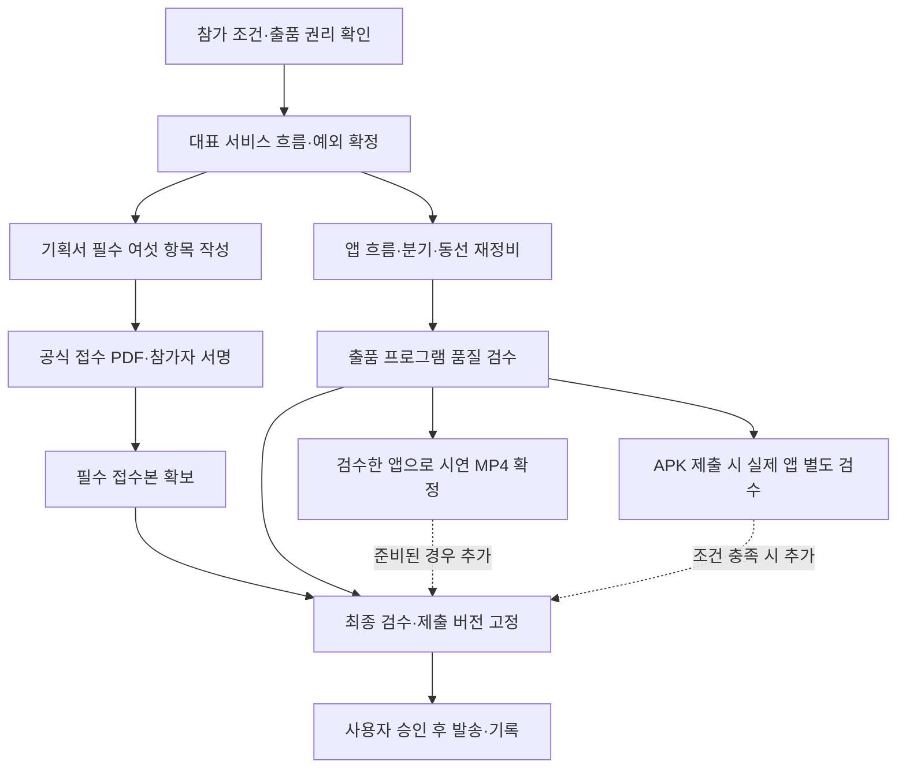

# 차량용 앱 공모전 최종 제출 패키지 계획

작성일은 2026-11-13이다. 기준 source는 `0f59db6`이다. 이 문서는 실행 전 계획이며 신청서 작성·새 제품 구현·영상 제작·APK 배포·서명·메일 발송을 완료했다는 기록이 아니다.

목표는 남은 작업일 안에 **현재 프로그램의 사용자 흐름을 재정비하고 실제 사용 검수를 통과한 앱을 기준으로 출품 패키지를 완성하는 것**이다. 공식 접수 최소요건과 우리 프로그램의 출품 품질 기준은 다르다. 현재 프로그램을 그대로 내거나, 선택 가산점이라는 이유로 앱 수정·검수를 생략하지 않는다. 신청서 작성은 병행하되 프로그램 검수 전에는 최종 영상·APK·제출본을 동결하지 않는다. 실행 전에는 운영자가 범위와 외부 발송 권한을 확인한다.

## 1. 공식 기준과 완료 조건

- 공식 마감은 **2026-11-15 23:59 KST**다. 필수는 작성·동의·서명한 공식 접수양식이다. 기획서·일반 시연 영상·첨부자료에는 별도 분량 제한이 없다. DOCX와 PDF, 패드·마우스 전자서명과 서명 이미지 삽입을 인정한다. 양식의 필수 항목과 순서를 지킨다.
- 영상은 목업·프로토타입·화면 녹화도 선택 가산점 자료로 인정한다. 소스·APK를 선택 제출할 때는 소스와 실행 가능한 release APK를 함께 제공한다. 개발 산출물별 가산점 수치는 공개되지 않았다.
- 실제 구동 앱 완성은 1차의 필수조건이 아니라 **12월 3~4일 2차 PT 전**의 의무다. 2차는 Pleos Connect 에뮬레이터에서 시연하며 실차는 필요하지 않다.
- 공식 근거는 [제출 안내](https://appdevchallenge.auto-hmg.io/guide/submission), [추가 공지 007](https://appdevchallenge.auto-hmg.io/notice/c0a1a000-2026-4923-8000-000000000007), [개발 범위 공지 008](https://appdevchallenge.auto-hmg.io/notice/c0a1a000-2026-4923-8000-000000000008), [공식 양식](https://appdevchallenge.auto-hmg.io/downloads/contest-application-consent.docx)이다. 세부 출처와 현재 공백은 [요건 조사](../../research/2026-11-13-contest-submission-requirements.md)를 따른다.

### 우리 프로그램의 출품 품질 기준

아래는 공모전이 모든 참가자에게 부과한 요건이 아니라 사용자가 정한 우리 출품의 필수 기준이다. **현재 프로그램은 출품 준비 완료가 아니다. 447/447이나 기존 영상·APK 존재만으로 이 판정을 바꿀 수 없다.**

- [ ] 제품 진입과 개발·시연 설정을 분리한다. 사용자가 개발 fixture나 시연용 외부 결과의 의미를 알아야만 다음 행동을 이해할 수 있는 상태를 출품본으로 삼지 않는다.
- [ ] 충돌 자동 감지를 제품의 필수 요구로 유지한다. 공식 충돌 상태, 센서 기반 충돌 의심 추정, 에뮬레이션 입력의 출처·시각·가용성을 구분한다. 감지 수단의 제약을 이유로 사용자 승인 없이 수동 진입 전용 서비스로 바꾸지 않는다.
- [ ] 사용자 상태·목표에 맞는 다음 행동과 분기를 제시한다. 모든 상황을 119 연결·직접 이동·기록·전송의 고정 순서로 밀어 넣지 않는다.
- [ ] 기록을 생략·보류해도 도움·지원 현황·나중에 재개에 접근할 수 있다. 반대로 보낼 자료와 승인이 없는 상태를 전송 성공으로 만들지 않는다.
- [ ] 사용자 행동과 외부 결과를 구분한다. 시연 결과는 명시적 시연으로 처리하고, 일반적인 다음 버튼이나 시간 경과만으로 통화·접수·도착을 확인한 것으로 만들지 않는다.
- [ ] 구호·차량 지원·기록·보험 전송을 적절한 병행 상태로 유지한다. 전송 거절·보류·미확인과 실제 지원 완료를 구분한다.
- [ ] 위험 발생 시 기록보다 대응을 우선하고, 중단·복귀에서 필요한 재확인과 작성 중 내용 보존을 확인한다.
- [ ] 공식 Pleos Connect 에뮬레이터의 차량 화면과 실제 Android 휴대폰에서 같은 사고 기록을 이어간다. 연결 권한, 저장, 연결 중단 후 복귀를 실제 두 기기로 확인하고 같은 browser의 보기 전환으로 대체하지 않는다.
- [ ] 유지하는 제품 진입·주요 기능·분기 전체의 동선을 검토한다. 대표 영상 한 개의 성공으로 다른 경로를 대체하거나, 동의 없이 미완성 기능을 숨겨 범위를 줄이지 않는다.
- [ ] 대표 흐름, 기록 보류, 전송 거절·미확인, 새 위험 발생 후 복귀를 실제 browser에서 조작하고 화면·문구·주 행동·입력·음성·저장 결과를 확인한다. 좁은 화면·확대 text에서도 핵심 조작이 가려지지 않는다.
- [ ] 위 검수의 source와 화면 증거를 기록한 뒤에만 영상과 APK를 최종화한다. APK를 제출하면 그 실행 화면과 구현 범위도 별도로 검증한다. Web 통과를 native 통과로 바꾸어 말하지 않는다.

예를 들어 모든 회귀 검사가 통과해도 기록 보류를 선택할 수 없거나, 프로그램의 앞뒤 순서를 설명할 수 없다면 이 기준은 미통과다. 프로그램 검수를 기획서·목업 영상으로 대신하지 않는다.

이번 작업은 다음 증거가 있을 때 완료한다.

- [ ] 실제 참가정보와 모든 참가자의 동의·본인 서명·날짜가 들어간 공식 접수 PDF를 확인한다.
- [ ] 심사용 작품 소개의 필수 여섯 항목이 현재 구현·향후 계획·가정을 구분하고 네 심사 기준을 설명한다.
- [ ] 위 프로그램 품질 기준을 통과한 source와 실제 사용 검수 증거를 확인한다. 현재 프로그램을 그대로 제출하는 경로는 최종 완료로 인정하지 않는다.
- [ ] 선택 제출물은 재생·다운로드·실행을 확인한 것만 포함하고, 해당 source와 최종 커밋을 추적한다.
- [ ] 공개 자료에 신청서·서명·연락처·비밀값을 넣지 않고, 실명·계정 노출 규칙의 미해결 범위를 임의로 면제하지 않는다.
- [ ] 승인된 최종 메일의 수신처·제목·CC·첨부·링크·커밋을 검수한다.
- [ ] 실제 발송을 지시받은 경우에만 발송하고 보낸 메일의 시각·첨부·발송 기록을 확인한다. 운영사 접수 확인은 발송 성공과 구분한다.

## 2. 구성할 산출물과 보관 위치

| 산출물 | 우선순위 | 포함 내용 | 완료 증거 |
| --- | --- | --- | --- |
| 공식 접수 PDF | 공식 필수, 앱 수정과 병행 | 01 참가정보, 02 작품 소개, 03 동의 내용, 04 참가자별 실제 동의·서명·날짜 | PDF 전체 페이지를 열어 양식 순서·내용·서명·잘림을 확인 |
| 제출용 서비스 흐름도와 전환 조건표 | 내부 필수 | 대표 상황, 핵심 분기, 병행 지원, 진입·생략·중단·복귀 조건, 기존 화면 대응 | 원고·앱·영상이 같은 흐름을 설명하고 예외를 끝까지 설명할 수 있음 |
| 출품 프로그램 | 우리 출품의 필수 작업 | 서비스 흐름·분기·동선 재정비와 제품·시연 설정 분리, 기존 기능 연결 | 프로그램 품질 기준의 실제 사용 검수와 변경 후 회귀 검사 통과 |
| 익명 시연 MP4 | 공식 선택 가산점, 우리 제출 목표 | 검수한 앱의 대표 흐름과 핵심 예외, 읽을 수 있는 UI·음성, 실제와 시연의 구분 | 프로그램 품질 통과 후 확정된 source에서 촬영하고 전체 재생 검수 |
| GitHub 소스와 release APK | 공식 선택 가산점, 제출 시 프로그램 품질 필수 | 제출 대상으로 정한 앱 source, 실행 가능한 release APK, README, 최종 커밋 | 기존 SC05 PoC를 그대로 포장하지 않고, 제출 범위의 실제 앱 설치·실행·동선과 source 일치 확인 |
| 제출 manifest와 메일 초안 | 내부 필수 | 파일명·SHA-256, 제출 source 커밋, 선택 링크, 받는 사람·제목·CC·본문 | 최종 PDF·영상·APK와 메일 기재 내용이 실제 파일·링크에 일치 |
| 발송 기록 | 실제 발송 시 필수 | 보낸 메일, 실제 발송시각, 첨부·링크, 수정 제출 이력, 운영사 회신 | 보낸 메일함 기록과 실제 제출본을 함께 보관 |

서명된 신청서와 편집용 DOCX는 **repo 밖의 비공개 제출 폴더**에 둔다. 공개 repo에는 넣지 않는다. 아래 이름은 작업상 권장일 뿐 공식 PDF·영상 파일명 규칙이 아니다. APK 파일명은 공식 규칙인 `팀명_앱이름_release.apk`를 따른다.

```text
비공개 제출 폴더/
  editable/application.docx
  final/application.pdf
  final/demo.mp4                    # 영상 제출을 선택하고 재생 검수를 통과한 경우
  final/submission-manifest.json    # 자기 자신의 hash는 포함하지 않음
  final/email-draft.txt
  receipts/                        # 발송한 뒤 기록과 회신 보관
```

공개 repo에는 내부 서비스 흐름 정본, 공개 가능한 화면 자료와 README를 둔다. APK를 제출하면 `apk/`에 두며 업로드 한도를 넘으면 GitHub Releases를 사용한다. 기획 원고는 공식 DOCX를 정본으로 두고 최종 PDF를 내보낸다. 별도 PPT·HTML 소개물이나 같은 내용의 기획서를 여러 벌 유지하는 작업은 기본 범위에서 뺀다.

## 3. 실행 순서와 병행 범위

실선은 필수 선행 관계다. 프로그램 품질 검수는 최종 제출 버전 고정의 필수 선행 단계다. 점선은 공식 선택 자료의 포함 여부를 뜻하며 프로그램 수정·검수의 생략을 허용하지 않는다.



### 단계 A. 참가 조건과 제출 전략을 고정한다

- [ ] 개인·팀, 참가 부문, 팀명·앱명, 대표자와 참가자 범위를 확인한다. GitHub 작성자 이름을 참가자의 법적 성명이나 팀 구성으로 추정하지 않는다.
- [ ] 기획·디자인·code·샘플 미디어·폰트·생성 음성의 출품 및 배포 권리를 확인한다. 기존 UX PDF의 작성자와 출품자의 관계는 임의로 가정하지 않는다.
- [ ] 작품 소개와 첨부물의 익명 조건을 확인한다. GitHub 계정명·커밋 작성자 실명은 공식 예외가 확인되지 않았으므로 운영사에 허용 범위를 문의할 항목으로 둔다. 답을 얻기 위해 필수 원고 작성을 중단할 필요는 없다.
- [ ] 앱 흐름 재정비와 실제 사용 검수를 우리 출품의 필수 작업으로 고정한다. 신청서는 병행하고 최종 영상·APK는 앱 검수 뒤 확정한다. 공식적으로 선택 제출인 배포 형식과 프로그램 자체의 품질을 구분한다. 숏폼은 기본 범위에서 제외한다.

이 단계에서 agent가 참가정보·서명·권리 확인을 꾸며 채우면 안 된다. 필수 원고는 먼저 확보할 수 있지만 이를 앱 품질 미달의 제출을 정당화하는 근거로 사용하지 않는다.

### 단계 B. 제출용 서비스 흐름을 먼저 확정한다

- [ ] 기존 구현 순서가 아닌 사용자의 상태와 목표를 기준으로 대표 상황 하나를 정한다. 응답 가능 여부, 정차 여부, 부상·현장 위험의 확인 상태, 지금 기록 가능한지를 별개 축으로 적는다.
- [ ] 충돌 신호에 의한 자동 진입과 감지 미지원·실패 시의 보조 수동 진입을 함께 설계한다. 감지 전 대기, 충돌 상태·충돌 의심 수신, 사용자 응답 확인을 구분한다. 폰 센서를 쓸 경우 사고 발생 전 연결·센서 수집이 필요하므로 사고 후 QR 연결만으로 감지를 소급 구현할 수 없다.
- [ ] 대표 흐름은 현재 상황 확인, 필요한 안전·도움 안내, 가능한 기록, 내용·전송 범위 확인, 결과와 남은 일 확인으로 설명한다. 모든 사고에 119 연결·직접 이동·사진 촬영을 일률적으로 강제하지 않는다.
- [ ] 각 행동에 시작 조건, 사용자 선택, 외부 결과, 생략, 위험 발생 시 중단, 재개 시 재확인 대상을 적는다. 새 안전·의료 판단 기준을 임의로 만들어 확정하지 않는다.
- [ ] 외부 구호·차량 지원의 진행과 기록을 병행 상태로 표현한다. 자료 전송 승인을 긴급 도움 연락의 선행 조건으로 삼지 않는다.
- [ ] 예외 1은 기록하기 어렵거나 원하지 않는 경우로 정한다. 기록을 생략·보류하고도 도움·현황·재개에 접근할 수 있어야 한다. 빈 기록을 전송 성공으로 위조하지 않는다.
- [ ] 예외 2는 보험 자료 전송을 거절·보류하거나 결과가 미확인인 경우로 정한다. 선택·미전송·외부 대기를 유지하고 모두 완료한 것으로 표현하지 않는다.
- [ ] 새 위험, 이동 불가, 응답 불가와 중단 후 복귀는 조건표로 함께 점검한다. 모든 분기를 긴 영상으로 만들 필요는 없다.
- [ ] 흐름도와 조건표를 한 문서에서 관리하고 기존 화면 캡처를 노드에 대응시킨다. 새로운 기획 도구·보드 앱은 만들지 않는다.

이 단계의 통과 조건은 대표 사례와 예외를 설명할 수 있고, 해야 할 일·보류 가능한 일·외부 대기를 혼동하지 않는 것이다. 확정 전에는 UI 순서를 다시 구현하지 않는다.

### 단계 C. 공식 기획서의 필수 여섯 항목을 작성한다

단계 B 이후에는 원고 작성과 앱 흐름 재정비를 병행한다. 둘 다 확정된 서비스 흐름을 정본으로 사용한다. 프로그램 수정은 선택 작업이 아니며, 문서 작성만 마쳤다고 완료 보고하지 않는다.

- [ ] 한 줄 소개에서 고객, 사고 직후의 문제, 제공할 핵심 가치를 설명한다.
- [ ] 기획 배경에서 관측한 근거와 아직 검증하지 못한 가설을 구분한다. 출처를 확인하지 못한 통계나 인과관계는 확정 수치로 쓰지 않는다.
- [ ] 주요 기능은 안전·기록·처리의 사용자 가치로 설명한다. 기능 목록만 나열하지 않고 휴대폰만 사용할 때와 다른 차량 특화 가치를 설명한다.
- [ ] 주요 사용 시나리오에 대표 흐름과 핵심 분기를 넣는다. 화면보다 상황·행동·다음 조건이 먼저 읽히게 한다.
- [ ] 개발 계획에는 현재 Web·Compose 구현과 실제 Pleos SDK 구현 계획을 분리한다. 현재는 Web 전체 여정과 Kotlin·Compose SC05 PoC이며 Pleos SDK dependency·실행 검증이 없다는 점을 사실대로 적는다.
- [ ] 개발 범위는 공개 SDK·API의 신호 의미와 접근 조건을 확인해 약속한다. 차량 마이크의 외부 STT 전송은 사용하지 않고 SpeechToText SDK를 계획한다. 별도 Fleet API의 공개 충돌 상태를 현재 Vehicle SDK·앱의 충돌 감지 구현 완료로 소개하지 않는다. 미확인 블랙박스·119·보험 API를 제공 확정 기능으로 쓰지 않는다.
- [ ] 기대효과에는 타깃, 서비스 도달 경로, 측정할 효과와 확장 가능성을 쓴다. 사고 지원 서비스에 근거 없는 일상 MAU·재이용률 성과를 붙이지 않는다. 수치가 필요하면 분모·계산식·가정을 적은 추정으로 표시한다.
- [ ] 네 심사 항목인 차량특화성·창의성·기술 활용성·사업성 각각에 원고 근거가 있는지 대조한다. 비공개 배점과 가산점 수치를 추정해 점수로 쓰지 않는다.

필수 여섯 항목이 작성된 원고를 먼저 확보한다. 참고자료 항목 7은 준비된 것만 연결하고 숏폼 항목 8은 미참여로 처리할 수 있다.

### 단계 D. 출품 프로그램의 흐름을 재정비하고 실제 사용을 검수한다

- [ ] 단계 B와 현재 앱의 주요 진입·기능·분기를 대조해 사용자 여정을 재구성한다. 화면 순서·전환 조건·다음 행동·생략·중단·복귀를 함께 고친다. 기록 강제, 사용자 행동과 외부 결과의 혼동, 전송 완료와 전체 지원 완료의 혼동을 해소한다. 단순한 화면 포장이나 영상 편집으로 문제를 가리지 않는다.
- [ ] 서비스 흐름을 성립시키는 데 필요한 구조·화면 변경은 수행한다. 반면 목적 없는 테마·효과 교체와 무관한 레거시 정리는 하지 않는다. 원본 board와 기존 사용자 preset은 보존하고 필요한 범위 변경은 명시한다.
- [ ] 바뀐 실제 행동을 browser에서 조작한다. 필요한 기존 회귀 검사를 실행하고, 정상 사례가 성공해도 예외가 새로 막히지 않았는지 확인한다. Web 최종 source는 `prototype/web`에서 `npm run check`와 `npm run test:ui`로 확인한다. 이전의 447/447을 변경 후 검증으로 재사용하지 않는다.
- [ ] 충돌 입력은 실제 SDK·센서 수신, 공식 형식의 시연 입력, 공급 불가 상태를 구분해 검수한다. 정상 주행·급제동·방지턱·휴대폰 낙하·신호 지연·단절을 충돌 확정으로 오인하지 않는지 확인한다. 실제 충돌 실험을 요구하거나, 입력 재생 성공을 감지 정확도 검증으로 바꾸어 말하지 않는다.
- [ ] 문서 상단의 프로그램 품질 기준을 모두 확인하고 실제 사용 검수 결과를 기록한다. 통과한 source에서만 최종 영상과 배포 패키지를 만든다. 대표 영상용 경로만 임시로 고쳐 전체 프로그램이 완성됐다고 표시하지 않는다.
- [ ] 품질 검수 후 확정된 source로 대표 흐름과 핵심 예외를 녹화한다. app 영역을 중심으로 촬영하고 실제·샘플·fixture·향후 연동을 구분한다. 실제 기관에 연락하거나 실제 사고 데이터를 만들지 않는다.
- [ ] 한 개의 MP4에 문제·차량 가치, 대표 이용 흐름, 예외 대응, 현재 구현·다음 개발 범위를 담는다. 목표 길이 3~5분은 작업상 권고이며 공식 제한이 아니다.
- [ ] 기존 JaeGyu 68개 중 필요한 안내를 사용하고 새 TTS 유료 호출을 기본 계획에 추가하지 않는다. 실제 청취가 필요한 판단은 사람 검수로 남긴다.
- [ ] 영상 파일 전체를 재생해 검은 화면, 잘린 글자, 음성 겹침·누락, 소리 크기, 개인정보·개발자 실명·OS 계정 노출을 확인한다. 자동 mux·decode 성공만으로 사람 청취를 완료 처리하지 않는다.

목업·화면 녹화도 공식 선택 자료이므로 모든 기능의 실제 연동을 만든 뒤에만 영상을 제출해야 하는 것은 아니다. 반대로 시연된 가상 결과를 실제 API의 성공으로 소개하지 않는다.

### 단계 E. 소스·APK 세트의 추가 제출을 판정한다

공식적으로 APK는 선택 제출이다. 그러나 APK를 제출할 때는 프로그램 품질 기준을 충족한 실제 앱이어야 한다. 앱 수정·검수를 선택 가산점 작업으로 낮추거나 기존 SC05 PoC를 완성 제품처럼 포장하지 않는다. 서명·배포 준비는 병행할 수 있지만 최종 패키지는 프로그램 검수 뒤 확정한다.

- [ ] 출품할 프로그램의 실행 대상과 기능 범위를 명시하고 원고·영상·source·APK를 일치시킨다. Native를 출품하면 해당 앱에도 제품의 핵심 사용 흐름을 적용하고 실제로 검수한다. Web 전체 여정과 SC05 PoC를 같은 완성 제품이라고 표시하지 않는다.
- [ ] 실행 가능한 release APK를 준비한다. release 서명 설정을 갖춘 뒤 `prototype/android`에서 `./gradlew assembleRelease`를 실행하고 실제 출력 파일을 확인한다. debug 앱과 instrumentation APK를 대신 올리지 않는다. 서명키·비밀번호·개인 경로는 repo 밖에서 관리하고 재설치·업데이트에 필요한 키를 보존한다.
- [ ] 제출할 앱을 실제 지원 환경에 설치·실행하고 제품 범위의 핵심 동작을 확인한다. 사용한 Pleos 에뮬레이터 버전·화면 규격을 실제 관찰로 기록한다. 일반 Google APIs AVD를 Pleos 에뮬레이터 검증으로 둔갑시키지 않는다.
- [ ] 루트 README를 심사자가 먼저 이해할 앱 소개와 실행 안내로 정리한다. board 편집기는 별도 경로로 유지한다. 앱 이름·한 줄 소개, 실행법, 테스트 환경·설정, Pleos 버전·규격, APK 위치 또는 Release 링크를 적는다.
- [ ] source와 APK를 함께 제공하고 APK 이름은 `팀명_앱이름_release.apk`로 맞춘다. `apk/` 또는 공식 안내가 허용하는 큰 파일의 Release 경로를 사용한다.
- [ ] 링크를 별도 세션에서 열어 접근·다운로드·설치를 확인한다. API 키·실제 개인정보를 공개하거나 라이선스 고지를 임의 삭제하지 않는다.
- [ ] APK의 실행 환경·서명·권리·익명성 조건을 해결하지 못하면 해당 가산점을 확정적으로 주장하지 않는다. 그렇더라도 프로그램 자체의 흐름 재정비·실사용 검수를 생략하지 않는다. 합의한 앱 범위를 바꿔야 한다면 사용자 승인 없이 기획서·영상만 내는 계획으로 축소하지 않는다.

이번에 합의한 Pleos 차량 화면과 실제 Android 휴대폰 이어받기는 이번 구현·검수 범위이며 2차 계획으로 미루지 않는다. 아직 합의하지 않은 전체 SDK 연동과 외부 제휴 기능은 별도 계획으로 구분한다. 가산점 때문에 급히 WebView 껍데기나 검증되지 않은 SDK 호출을 추가하는 일을 기본 해법으로 삼지 않는다.

### 단계 F. 공식 양식에 조합하고 최종본을 동결한다

- [ ] 참가정보와 작품 소개를 공식 양식의 순서대로 넣고 전원의 실제 동의·서명·날짜를 받는다. 운영용 정보는 해당 절에만 두고 심사용 작품 소개에는 성명·소속·전화·이메일을 넣지 않는다.
- [ ] 최종 제출 형식은 PDF를 기본으로 정한다. 편집용 DOCX는 비공개 폴더에 보관한다. PDF는 글꼴·줄바꿈·이미지·표·서명·전체 페이지를 실제로 열어 검수한다.
- [ ] 최종 공개 source·README·선택 APK를 커밋·push하고 실제 원격 HEAD를 확인한다. 그 커밋을 접수 메일의 최종 커밋으로 사용한다. APK의 build source와 제출 커밋을 구분해 추적할 수 있게 한다.
- [ ] 제출 manifest는 최종 커밋을 읽은 뒤 repo 밖에 만든다. 자신의 hash를 자신에게 넣거나, 메일에 쓸 커밋 해시를 그 커밋 자체에 넣으려는 순환을 만들지 않는다.
- [ ] manifest에 최종 PDF·선택 영상·선택 APK의 파일명·바이트·SHA-256과 다운로드 URL·제출 커밋을 기록한다. 서명 파일과 본문 개인정보를 public repo에 복사하지 않는다.
- [ ] 완료된 선택 자료만 기획서 참고자료 항목과 메일에 연결한다. 존재하지 않는 파일·권한이 필요한 링크·곧 만료되는 URL은 빼거나 해결한다.
- [ ] 익명 심사와 GitHub 계정·커밋 작성자의 충돌이 남아 있으면 해소됐다고 선언하지 않는다. 운영사 확인과 허용된 대체 제출 경로를 검토하고, 동의 없이 기존 Git 이력을 재작성하지 않는다.

신청서 원고·서명 준비는 앱 수정과 병행한다. 그러나 프로그램 품질이 미통과인 상태를 최종 출품 준비 완료로 선언하지 않는다. 마감과 품질이 충돌하면 미완료 사실과 선택지를 명시해 사용자와 제출 범위를 다시 합의한다. 공식적인 수정 제출 허용을 현재 프로그램을 그대로 내도 된다는 근거로 사용하지 않는다.

### 단계 G. 최종 승인 후 발송하고 기록한다

- [ ] 받을 주소를 `appdevchallenge@hyundai-partners.com`으로 확인한다.
- [ ] 제목을 `[차량용 앱 개발 공모전] 팀명(개인은 성명)_대표자명`으로 맞춘다.
- [ ] 팀으로 참가하면 전원 본인 동의·서명을 확인하고 팀원 전원을 CC에 포함한다. 발신자가 대표자가 아니어도 가능하지만 후속 수정은 같은 발신자 주소를 사용한다.
- [ ] 본문에는 작품명·첨부 목록·선택 영상·source URL·APK 경로 또는 Release URL·최종 커밋 해시와 현재 구현 범위를 명확히 적는다.
- [ ] 초안 저장·발송 버튼 클릭·보낸 편지함 기록·운영사 수신/접수 회신을 구분한다. 이미 보낸 기록을 확인하지 않고 같은 메일을 반복 자동 발송하지 않는다.
- [ ] 외부 메일 발송은 사용자 최종 승인과 발송 계정 접근 권한이 있을 때만 수행한다. 이 계획이나 일반적인 개발 자율권을 참가 서명·제출 승인으로 대체하지 않는다.
- [ ] 발송 후 실제 보낸 메일의 수신처·CC·시각·첨부·링크·본문을 manifest와 대조한다. 보낸 기록을 비공개 receipts에 보관한다. 운영사 회신이 없으면 접수 확정으로 단정하지 않는다.

수정 제출은 마감 전, 처음 발신한 주소에서 `[수정제출] [차량용 앱 개발 공모전] 팀명(개인은 성명)_대표자명`으로 보낸다. 기존 파일을 포함한 전체 제출물과 서명한 동의서를 다시 첨부하고 전원 CC를 유지한다. 준비한 새 파일과 실제 발송본을 구분해 버전별로 보관하며 마감 전 마지막 발송본을 최종본으로 관리한다.

## 4. 범위가 늘어날 때 적용할 중단 기준

- 서류 작성·권리 확인과 프로그램 흐름 수정·실사용 검수를 함께 최우선으로 진행한다. 둘 중 하나를 숏폼·새 장식·무관한 최적화·기능 확장보다 뒤로 미루지 않는다. 서명 대기 때문에 실행 가능한 앱 수정까지 멈추지 않는다.
- SDK가 공개하지 않은 기능이 필요하면 실제 연동 약속을 늘리는 대신 향후 계획으로 분리한다.
- APK 배포가 새 플랫폼 작업이나 외부 권한에 의존하면 의존성과 현재 상태를 명시한다. 단 한 번의 실패로 불가능이라고 단정하지 않고 도구·문서로 확인 가능한 부분을 마친다. 이를 이유로 프로그램 품질 기준을 없애거나 사용자 승인 없이 제출 범위를 축소하지 않는다.
- 실제 동작과 기획 주장이 다르면 먼저 기획·시연·구현 범위를 일치시킨다. 미구현 기능에 가짜 성공·고정값·묵음·임의 통계를 붙이지 않는다.
- 마감보다 충분히 앞서 필수 접수본을 제출하는 것을 권장한다. 내부 목표는 공식 마감이 아니며 선택 작업 때문에 공식 접수 마감 시각을 넘기면 안 된다.
- 서명된 신청서·동의서·메일 원문은 public repo 밖에 두고 임시 파일도 같은 원칙을 지킨다.

## 5. 사람 확인이 필요한 항목

| 확인 | 필요한 이유 | 병행 가능한 작업 |
| --- | --- | --- |
| 참가 단위·부문·팀명·최종 앱명·참가자 정보 | Repo·GitHub 계정·원본 PDF만으로 공식 참가자를 확정할 수 없음 | 비식별 기획 원고·서비스 흐름·시연 초안 |
| 참가자별 실제 동의·본인 서명·날짜·CC 동의 | 양식의 본인 동의 요구이며 agent가 대리 생성하면 안 됨 | PDF의 작품 소개·화면 구성·공개 산출물 검수 |
| 원본 기획·디자인·미디어 권리와 기존 수상작 여부 | 순수 창작·출품 권리 규정 충족 필요 | 소유권이 확인된 source·fixture 범위 분석 |
| GitHub 계정·커밋 실명에 대한 운영사 해석 | 공개 제출 안내와 양식의 계정정보 비노출 요구가 명확히 연결되지 않음 | 필수 신청서·익명 영상·공개 가능한 문서 준비 |
| 최종 접수본·수신처·발신 계정·발송 승인 | 참가 신청과 외부 발송은 별도 행위 | 최종본 생성·링크 점검·메일 초안까지 |

## 6. 이번 계획에서 하지 않는 일

기획 도구 새 개발, 무관한 레거시 삭제, 목적 없는 디자인 시스템 교체, 실제119·보험사·정비소 연계, 실차 검증, 숏폼 특별상 준비를 필수 경로에 넣지 않는다. 이는 출품 프로그램을 그대로 내거나 핵심 흐름 수정을 미루는 결정이 아니다. 사용자가 요구한 앱 흐름·사용성 재정비에 필요한 변경과 실제 사용 검수는 이번 작업의 필수 범위다.

Sequence Work into Verifiable Units 원칙으로 각 단계는 실제 산출물 검수 후 다음 단계로 진행한다. Make Operations Idempotent 원칙으로 최종 manifest와 실제 발송 기록을 기준으로 제출본을 구별하고 중복 발송을 막는다.

## 7. 사용자 확정 결정

### 결정 1. 대표 사용 상황

사용자는 일반도로의 경미한 사고를 대표 상황으로 선택했다. 사용자가 응답 가능하고 급한 위험이 해소됐다고 확인한 뒤 현장 기록·경위 정리·보험 처리를 돕는 경험을 중심에 둔다.

고속도로 사고와 부상·위험 대응을 자동 제외하는 결정은 아니다. 새로운 부상·위험 또는 응답 불가가 있으면 기록·보험보다 필요한 긴급 대응을 우선하는 분기를 유지한다. 대표 상황 선정만으로 기존 기능을 삭제하거나 실제 의료·현장 안전을 앱이 확정한 것으로 표시하지 않는다.

### 결정 2. 핵심 완료 목표

사용자는 사고 자료·경위서를 확인하고 보험사에 보낼 범위를 승인한 뒤 접수 여부와 남은 일을 구분하는 것까지를 핵심 목표로 선택했다. 정비소·길 안내·대차는 보조 기능으로 둔다.

핵심 목표의 우선순위를 정한 것이며 기존 보조 기능의 자동 삭제 승인은 아니다. 현재 실제 보험사·정비소 API가 연결되지 않은 사실은 그대로 명시하고, 실제 결과와 시연으로 공급한 접수 상태를 혼동하지 않는다.

### 결정 3. 차량과 휴대폰 역할

사용자는 차량이 사고 상황·차량 정보·안내·진행 현황을 보여주고, 휴대폰이 현장 촬영·진술·경위서 수정·전송 승인을 맡는 구성을 선택했다.

이는 제품의 역할 분담이며 실제 기기 간 동기화의 구현 완료를 뜻하지 않는다. 현재 동일 browser의 보기 전환과 실제 차량·휴대폰 사이의 기록 전달은 구분하며, 연결 범위는 별도 결정으로 확정한다.

### 확인사항. 실제 검수 장비

사용자는 Android 휴대폰과 iPhone을 모두 보유하고 있으며 Android 실기기를 우선 활용하는 방향을 선호했다. Android는 실제 설치·카메라·마이크·이어받기 검수의 우선 기기로, iPhone은 모바일 웹 추가 검수 후보로 둔다.

실차 없이도 공식 Pleos Connect 에뮬레이터로 차량 실행 환경을 검수할 수 있다. 이번 로컬 확인에서는 일반 Android AVD `sdk-test-35`와 Google APIs API35 이미지 하나만 확인됐고, 공식 Pleos 이미지는 설치되지 않았다. 따라서 Pleos 설치·실행과 실제 휴대폰 기록 전달은 아직 수행하지 않은 별도 작업이다. 에뮬레이터 제공만으로 기기 간 연결이 완성되는 것은 아니다.

### 결정 4. 실제 차량·휴대폰 이어받기

사용자는 공식 Pleos Connect 에뮬레이터에서 실행하는 차량 화면과 실제 Android 휴대폰 사이의 이어받기를 이번 구현 범위로 선택했다. 차량 화면의 QR 또는 연결 코드로 휴대폰 작업 화면을 열고 같은 사고 기록을 이어간다.

연결 권한, 기록 전달·저장, 연결 끊김 후 복귀와 실제 두 기기 검수를 포함한다. 같은 browser의 device 보기 전환으로 이 요구를 대체하지 않는다. 실차 검증이나 다수 사용자를 위한 상용 동기화 완료를 주장하지 않으며, 에뮬레이터 설치·실행과 실제 연결은 구현·검수로 입증한다.

### 필수 요구 재확인. 충돌 자동 감지

사용자는 충돌 자동 감지를 빼면 안 되며, 직접 신호가 제한되면 비전이나 다른 센서를 활용하는 계획을 마련하라고 지시했다. 수동 시작을 기본 전제로 제시했던 진입 질문은 확정되지 않았다. 감지 기능을 삭제하거나 수동 진입만 남기는 결정은 없다.

[충돌 감지 지원 조사와 개발 계획](../../research/2026-11-14-collision-detection-feasibility.md)을 근거로 실제 가능한 입력, 계약·권한이 필요한 입력, 연구·제휴 계획을 분리한다. 현재 앱의 고정 `0.4 G` 등의 fixture는 실제 감지 증거가 아니다. 감지 입력의 출처와 지원 상태를 숨기지 않으며, 실제 자동 감지 범위와 운행 전 폰 연결 여부는 이어지는 주요 결정에서 확정한다.

조사 결과 공개 `Vehicle:2.3.2` AAR에서 좌석별 에어백 전개 capability·조회·변경 콜백과 `CAR_SAFETY` 권한을 직접 확인했다. 별도 Fleet API에도 `Emergency.Crash`가 공개돼 있지만 계약·승인이 필요하다. 에어백 미전개 경미 사고의 감지를 전개 신호 하나로 보장하지 않으며, 폰 IMU 보조와 제휴 비전의 입력 조건·오탐·미탐 검증 계획을 함께 정리했다. 공개 API 확인과 전용 에뮬레이터·실기기 수신 검수는 별개다.
