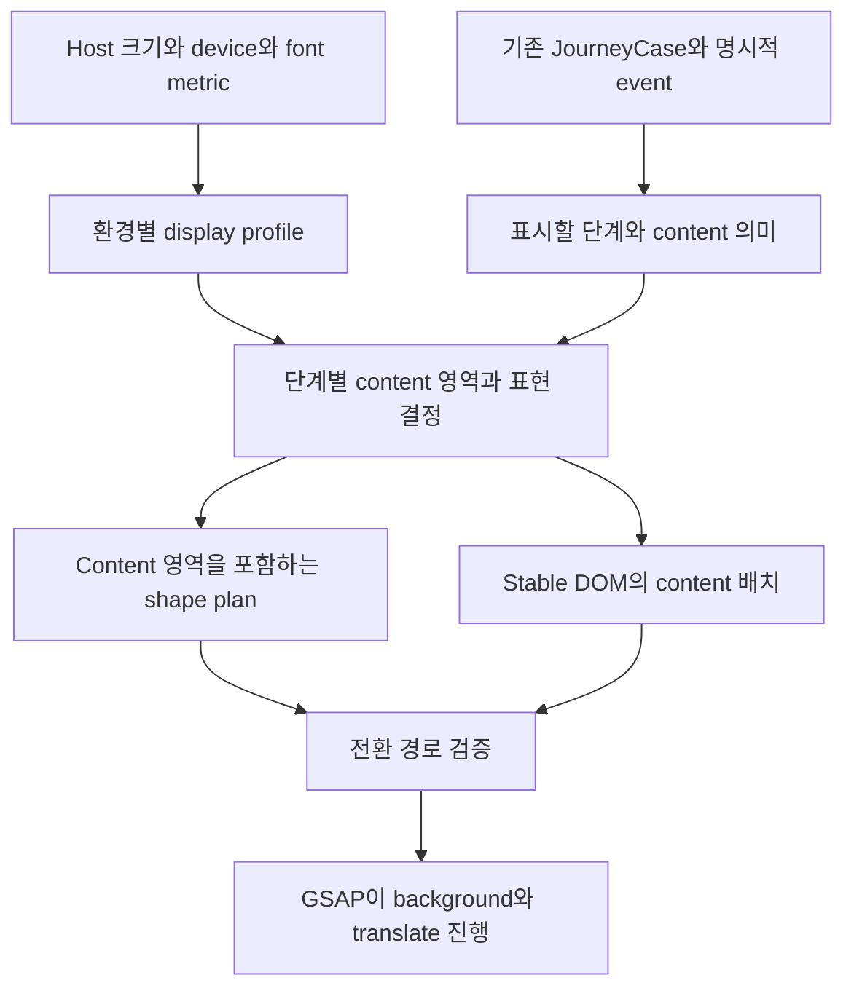
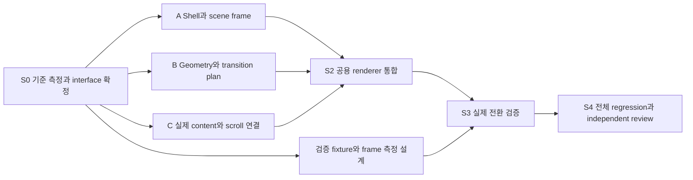

# 일정한 화면 높이와 안정된 content를 위한 Voronoi layout

작성일: 2026-11-12. 상태: **방향 승인, builder check를 마친 상세 spec 검토본**. 이 문서 작성으로 제품 code가 변경되지는 않음.

사용자 요청: 단계마다 화면 height가 달라지고, Voronoi가 커지는 동안 text가 흔들리는 문제의 근본 해결. 승인 방향은 차량 화면의 외곽 height 유지, 안정된 content 배치, 그 주변에서 움직이는 Voronoi surface, 긴 기록의 내부 scroll. 전체 spec과 parallelization 검토 요청에 따라 작성.

이 문서의 세부 interface·예외·검증 수치는 아래 근거를 바탕으로 작성자가 제안한 설계 결정. 사용자가 개별 수치까지 승인한 것으로 간주하지 않음.

## 1. 근거와 적용 우선순위

- 현재 구현 기준: `feat/journey-visual-integration`, `9a3b81e`. 직전 전체 검증 351/351 통과는 기능·저장·기본 가독성의 근거이며, 이번 motion 품질의 합격 근거로 재사용하지 않음.
- [당시 참조한 시각 기준](2026-11-12-figma-visual-contract.md): 원래 문서는 색·font·type·touch·material의 “승인된 정본”으로 참조됐으나 원문은 확보하지 못했다. 2026-11-13 해당 경로를 **출처가 있는 현행 구현 기준**으로 재구성했다. 사용자 승인 원문 복원이나 새로운 세부 승인으로 간주하지 않는다.
- [기존 단계·layout spec](2026-11-11-stage-layout-preview-design.md): Global 7단계, checklist, 통화·전송·접수 구분의 정본.
- Figma 근거는 저장 snapshot `2026-11-11T12:47:35Z`. 이번 문서는 live Figma 대조 결과가 아님.
- 본 문서 승인 시 기존 spec의 **매 frame 최대 content rectangle 선택, 내용 overflow에 따른 board 전체 stack 전환, 내용 위에 겹치는 sticky action bar, 사용자 작업을 기다리게 하는 geometry 시작 간격4000ms**를 대체. 기존 색·domain 상태·저장 규칙은 대체하지 않음.
- 날짜가 있는 기존 문서는 변경하지 않고 이 문서에서 변경 범위와 근거를 연결.

## 2. 현재 원인과 재현 근거

| 관찰 | 현재 구현 | 결과 |
|---|---|---|
| 기록 단계에서 전체 화면이 길어짐 | `FlowBoard`는 평시 `height = width × 1184 / 1236`, content overflow 시 `.fs-board[data-stack=true] { height:auto }` | 동일 viewport에서 단계·문구 길이가 외곽 height를 결정 |
| Voronoi 경계가 움직일 때 글자 위치가 튐 | `flow-geometry.ts`의 `contentRect()`가 18개 수직 구간의 후보 중 최대 면적 rectangle을 선택 | 근접 후보의 우열이 바뀌면 content 좌표가 불연속적으로 변경 |
| 줄바꿈과 text 묶음의 중심이 흔들림 | `FlowBoard`가 매 frame content `left/top/width/height`를 갱신하고 body를 중앙 정렬 | 폭 변경에 따른 reflow와 높이 변경에 따른 재정렬 발생 |
| 일부 문구가 전환 도중 달라짐 | geometry 크기에 따라 `compact`를 매 frame 판정 | 표시 내용·font role이 geometry 진행에 결합 |
| 화면 위치가 추가로 달라짐 | 전환 뒤 editor의 document `scrollIntoView`, 겹치는 action bar, 별도 높이 규칙의 차량 scene | shell 변화와 scroll 변화가 사용자에게 함께 보임 |

Read-only 계산 재현: board width 912 CSS px, height `912 × 1184 / 1236`에서 `detect → evacuate` weights를 선형으로 72구간·720구간 계산. 연속 두 표본 모두 content width≥155px·height≥205px인 cell만 비교해도 최대 좌표 변화 약 55.06px·55.85px 관찰. 이는 실제 browser FPS 측정이 아니라 **geometry 함수의 불연속성**을 확인한 결과. 구간을 늘리는 것만으로 불연속이 사라지지 않음.

`transform` 추가, debounce, easing 변경, text를 흐리게 처리하는 것만으로 위 책임 결합이 해소되지는 않음.

## 3. 목표와 완료 불변조건

1. 같은 display 환경에서 1–7단계가 진행되어도 제품 stage 외곽과 좌우 panel의 위·아래 경계 유지.
2. 동일 content는 geometry 전환 중 font size·line height·letter spacing·줄바꿈 유지. 의도한 위치 이동만 허용.
3. Voronoi는 읽기 가능한 content 영역을 침범하지 않는 범위에서 연속적으로 변형.
4. 실제 record/review editor DOM, draft, selection, focus, media, scroll 위치 유지. Read-only 모형으로 editor 대체 금지.
5. 긴 내용은 정해진 작업 영역에서 접근 가능. 내용 길이가 display mode를 바꾸지 않음.
6. 위험 정보와 통화 상태는 motion 대기·fade·queue 때문에 늦게 표시되거나 사라지지 않음.
7. Main Journey·Flow preview·Catalog의 실제 Journey가 동일한 layout contract 사용.
8. 이전의 기능 검증에 더해 **전환 중 frame**의 외곽·text·focus·shape 관계 검증.

보존할 시각 기준: Guide blue/violet,119 copper,평시 neutral gray,기존 notification, B″·grain·미세한 CA. Asta와2560×1440 typography 위계 유지. 작은 화면의 기본 크기 하한은 행동 제목28px·본문18px·보조15px·상태 label14px이며 사용자 text 확대에 함께 증가. Vehicle64×64px·실제 mobile48×48px hit area 유지.

비범위: 새 시각 취향·font·material 도입, 새로운 physics/3D engine, 전체 scenario 재설계, domain model 교체, 실제 차량·119·보험사 API, 영상 제작, Figma 편집, push·merge.

## 4. Approaches와 선택

| 방식 | 장점 | 제약 | 결정 |
|---|---|---|---|
| 안정된 content 영역을 먼저 배치하고 Voronoi를 그 주변에서 변형 | 기존 디자인의 연속성과 실제 editor 기능 유지. Height·text 안정성을 각각 검증 가능 | 자유로운 shape 변화에 제한 필요. Content와 shape 사이의 검증 contract 필요 | **대화에서 선택한 방향** |
| Voronoi는 요약에만 사용하고 작성·검토는 별도 직사각형 workspace | 구현 단순, 복잡한 form에 넉넉한 공간 | 단계 사이의 시각적 연속성 감소 | 독립적인 대안으로 미선택 |

최대 rectangle의 좌표에 smoothing만 추가하는 방식은 후보에서 제외. 지연된 좌표가 polygon 밖으로 나갈 수 있고, 폭에 따른 reflow와 `height:auto` 전환을 해결하지 못함.

선택안의 제약: 모든 중간 frame에서 기존 weight·면적비를 그대로 유지하는 것이 목표는 아님. 가독성·상태 노출·안정된 조작 영역이 hard constraint이며, 기존 seed·면적비·기울기는 그 안에서 보존할 시각 목표.

## 5. 화면 height와 scroll의 소유권

### 5.1 제품 stage와 검토용 page 분리

- 제품 stage는 차량 status, 진행·action 영역, 좌우 content, dock를 포함하는 하나의 bounded 영역.
- Scenario 선택, simulation 결과 button, debug readout, 저장 상태 상세는 검토용 page의 바깥 영역. 제품 stage의 크기 계산에 포함하지 않음.
- Main page에서는 검토용 header·설정을 제품 stage 위에 두되 접을 수 있는 기존 control 영역으로 정리. Case 시작 시 stage가 viewport에 오도록 최초 한 번만 이동 가능.
- 제품 stage 안에서는 단계 이동만으로 document scroll을 변경하지 않음. 외부 설정을 보려고 사용자가 page를 scroll하는 동작은 별개.
- Catalog에서는 host가 제공하는 preview 크기를 사용. Catalog 전체 page를 viewport 높이로 고정하지 않음.
- 공용 `VehicleShell`의 기존 caller를 일괄 변경하지 않음. Bounded presentation은 명시적으로 선택하는 공용 방식으로 추가하고 Journey·Flow preview가 사용.

### 5.2 높이 계산

`stageHeight`는 host의 사용 가능한 높이로 결정. Main host는 dynamic viewport 높이와 바깥 여백, Catalog host는 지정된 preview 높이를 사용. `boardWidth`나 editor 내용에서 높이를 역산하지 않음.

Content 높이는 `stageHeight`에서 status·진행/action·dock·고정 gap을 제외한 값. 좌측 scene과 우측 board는 이 content 높이를 공유. CSS grid/flex의 `minmax(0,1fr)`·`min-height:0`에 해당하는 bounded 크기 전파 필요.

넓은 차량 profile의 좌우 배분은 기존 1:1 유지. Gap을 제외한 두 column의 너비를 동일하게 하고, Global 단계에 따라 좌측 차량 pane의 비중을 바꾸지 않음.

진행/action 영역은 현재 문구의 순간 높이 대신 해당 display profile에서 **전체 7단계의 지원 문구를 수용하는 예약 높이** 사용. Font 준비와 환경 변경 시 계산하고 단계마다 다시 측정하지 않음. 위험 안내의 짧은 label과 확인 action 자리도 예약. 긴 설명은 내부 detail에서 제공하며 critical 안내를 생략하지 않음.

일반 viewport에서 다음 항목의 높이는 단계·checklist·통화 상태·기록 길이에 영향을 받지 않음: 제품 stage, 좌측 panel, 우측 board, action 영역, status, dock.

### 5.3 Scroll 규칙

| 영역 | Scroll 소유권 |
|---|---|
| 제품 stage와 Voronoi board | 정상 bounded mode에서 자체 scroll 없음 |
| 우측 현재 작업 | 활성 editor의 body 한 곳에서 세로 scroll. 제목·필수 action은 같은 bounded cell 안에서 별도 row |
| Textarea | 자체 입력 scroll 허용. 전체 workspace와 textarea가 각각 필요한 경우만 중첩 허용 |
| 비활성 cell | Scroll·focus·pointer 입력에 참여하지 않음. 기존 DOM과 저장하지 않은 입력 유지 |
| 차량 scene | Scene viewport는 고정. 긴 상세 설명만 별도 bounded detail body에서 scroll |
| Mobile·접근성 page | 아래 profile 정책에 따름. 차량 화면을 단순 축소하지 않음 |

Voice listening/review, 사진 추가, report 문장 추가, payload 미리보기 때문에 외곽 크기 변경 금지. Textarea의 사용자 resize도 작업 body 경계 안에서만 작동. 내부 scroll 위치는 workspace별로 유지하고, 높이가 줄면 유효한 최대값으로만 clamp.

## 6. Display profile과 접근성

Profile은 **host 크기·device 용도·font metric**으로 결정. Global 단계, 입력 길이, request 상태는 profile 선택의 입력이 아님.

| Profile | 공간 사용 | Height 규칙 |
|---|---|---|
| 넓은 차량 | 좌측 scene·우측 adaptive board를 병렬 배치 | 제품 stage와 두 panel 경계 고정 |
| 좁은 차량 | 하나의 작업 pane을 우선 표시하고 차량 context는 명시적 전환으로 접근. 통화 상태와 주요 action 유지 | Bounded height 유지. 차량 hit area 64px 유지 |
| 실제 mobile | 하나의 활성 작업과 접근 가능한 차량 context, 동일한 사실·action 제공 | Mobile 전용 구성. 48px hit area. 긴 내용은 해당 작업에서 scroll |
| 접근성 문서 배치 | 확대 text·짧은 viewport 등으로 bounded 구성이 필수 action과 읽을 영역을 동시에 확보할 수 없는 경우 | 명시적으로 document flow 사용. 단계별 overflow로 선택하지 않음 |

Profile 선택은 최초와 환경 변경 시만 실행. 한 profile에서 지원하는 전체 단계의 최소 요구 공간으로 판정하므로 기록 단계에서 갑자기 stack으로 바뀌지 않음. Mode 이름과 변경 이유는 검증용 metadata로만 제공.

Bounded profile의 최소 가용 작업 높이는 현 profile 본문 line height의 3배와 해당 장면의 필수 control row를 함께 수용해야 함. 이 공간을 확보할 수 없으면 접근성 문서 배치. 세부 breakpoint는 S0 실측으로 확정하며, 1150px·540px 같은 기존 숫자를 근거 없이 재사용하지 않음.

실제 mobile과 좁은 차량은 별도 용도. `device=vehicle`은 어떤 viewport에서도 64×64px 유지. 200% text를 보상하는 scale·zoom·font 축소 금지. 접근성 문서 배치에는 고정 height 합격 조건을 억지로 적용하지 않고 가독성·reachability·전환 중 text 안정성 조건 적용.

이 예외는 작성자의 접근성 제안. 보통 크기의 차량 화면이 내용 overflow만으로 이 예외에 들어가는 것은 결함으로 판정.

넓은 차량 profile에서는 전체 1–7단계의 Voronoi 표현 유지. 좁은 차량·실제 mobile·접근성 문서 profile에는 일반 rounded rectangle workspace 허용. 이 예외는 환경별 공용 배치이며, §4의 미선택 대안처럼 모든 작성 단계를 별도 page로 분리하는 것이 아님. 동일한 editor DOM을 유지하고 CSS slot·표현만 변경. Containment는 각 profile의 실제 surface 경계에 대해 검사하며, rectangular profile에 power diagram을 강제하지 않음.

## 7. Content·geometry·motion의 책임 분리

### 7.1 Content plan

- 단계별로 표시할 cell, 읽기 가능한 slot, `full/summary` 표현, scroll body를 먼저 결정.
- Slot은 source·target endpoint에서만 계산. 매 frame의 최대 면적 rectangle을 text 배치에 사용하지 않음.
- 기본 text 묶음은 top/leading anchor 사용. 공간이 변할 때 전체 block의 중앙을 계속 재계산하지 않음.
- 119의 핵심 상태는 profile별 고정 anchor 사용. 큰 번호·spectrum은 여유 공간에 따른 장식적 표현이며, 연결/종료·접수 label의 가시성이 우선.
- `compact`는 현재 polygon 폭의 threshold가 아닌 endpoint content plan의 명시적 variant. Frame 중 variant 변경 금지.
- 긴 사용자 기록은 slot의 body 안에서 wrap·scroll. Layout solver가 전체 기록의 높이를 수용하려고 cell이나 shell을 확장하지 않음.
- Viewport·font가 같고 내용 의미가 같으면 endpoint 결과는 결정적이어야 함. Font 준비 전의 임시 metric을 사용한 morph 금지.

### 7.2 Shape plan

- 기존 power diagram, inset, `roundedPath`, seed·weight를 재사용해 최초 후보 생성. `contentRect()`는 이전 모습 비교용으로 사용할 수 있으나 animation의 text 좌표 공급자로 사용하지 않음.
- 먼저 확보한 content slot의 모서리, control hit area, focus ring 여유가 최종 rounded surface 안에 들어가는지 검증. 원 polygon의 corner 검사만으로 rounded boundary 안전성을 주장하지 않음.
- Profile별 endpoint 후보는 기존 시각 목표 가까이에서 미리 결정. Runtime에 임의의 global optimizer나 새 geometry dependency 도입 금지.
- 기존 후보가 공간을 제공하지 못하면 같은 profile 안에서 우선순위 cell을 넓힌 endpoint 후보 사용. 그래도 불가능한 환경은 profile 판정에서 제외. 내용 길이를 이유로 frame 중 일반 card 목록으로 바꾸지 않음.
- 기존 면적 목표는 선호값. Slot containment·touch·가독성을 충족하기 위해 달라진 면적비는 preview에 기록하고 review. 기존 면적 assertion을 삭제하여 숨기지 않음.
- Shape path는 한 owner가 갱신. Material layer는 content와 분리하고 pointer 입력을 받지 않음. Shape·grain·CA 변화가 glyph의 filter나 scale로 전달되지 않음.

### 7.3 전환 중 text

1. 현재와 다음 content plan을 준비하고 target geometry의 유효성 확인.
2. 유지되는 content의 폭·font·line break를 고정. 이동이 필요한 경우 묶음 전체의 `translate(x,y)`만 연속 보간.
3. Background는 같은 timeline의 shape 진행률을 사용. Source·target뿐 아니라 중간 경로에서도 visible content와 겹치지 않아야 함.
4. 폭 변경이나 다른 줄바꿈이 필요한 비긴급 content는 같은 DOM의 opacity가 0인 commit 시점에 한 번 변경한 뒤 기존 fade로 표시. 매 frame 폭 변경 금지.
5. 다음 content가 안정된 뒤 의미에 맞는 focus를 이동. Media나 input을 다시 mount하지 않음.

Source·target slot의 단순 보간만으로 containment가 보장되지는 않음. Slot 이동과 shape 전환의 조합을 함께 검증. 안전한 공통 영역이 없으면 해당 비긴급 content를 먼저 fade out한 뒤 shape를 이동하고 최종 slot에서 표시. 이를 은폐 수단으로 사용해 통화 상태나 위험 action을 숨기지 않음.

Active editor는 viewport 변경 등 불가피한 환경 변경을 제외하면 typing 중 이동하지 않음. 상태 label만 바뀌는 event는 geometry 재배치의 이유가 아님. 사용자가 단계 이동을 요청하면 기존 저장·이탈 guard를 통과한 뒤 전환.

## 8. 단계별 표시와 scene 보존

| Global/상태 | 표시 규칙 | 유지할 항목 |
|---|---|---|
| 1 감지 | Guide와119 중심 `detect` | 차량 pane·외곽·action 자리 |
| 2 통화 연결 | `detect` 유지, 연결 사실과 notification만 갱신 | 내용 폭·글자 anchor |
| 3 대피 안내 | `evacuate`, checklist에 필요한 영역 사전 확보 | 119 핵심 상태 |
| 4 안전 확보 | `safe`, 다음 기록에 필요한 workspace 공간까지 예약 | 도착과 checklist 사실 분리 |
| 5 기록 | 같은 `safe` shape. 예약된 slot에서 실제 voice/photo editor 활성화 | Draft·caret·recording·scroll |
| 6 검토 | `review`, 실제 review/submission workspace 활성화 | 선택 자료·수신처·승인 payload |
| 6 전송 중 | `sending`, 승인된 내용의 진행 표시 | 현재 통화, 실패 시 돌아갈 editor DOM |
| 6 실패 | `review`로 복귀 | 이전 승인 내용과 retry identity 규칙 |
| 7 전송 완료·통화 중 | `sending` 유지 | 전송과 접수 미확인 구분·통화 상태 |
| 7 통화 종료 | 같은 외곽 안에서 `calm` | 완료 내용 접근·공유·후속 처리 |

좌측의 차량/current/front/replay는 같은 scene instance 유지. Scene viewport를 남은 bounded 공간에 맞추고, 도로·차량 그림은 aspect ratio를 유지해 fit. 차량 그림의 확대·축소는 text의 축소와 분리. Header·replay transport·detail이 scene의 외곽 height를 바꾸지 않도록 예약 row와 내부 detail body 사용.

Scene view 변경만으로 우측 입력·통화·Global 단계·document scroll을 바꾸지 않음. Replay seek·재생 속도·일시정지·현재 상황 clock과 signal 처리 보존.

## 9. Transition lifecycle와 focus

Presentation 상태는 `idle → prepare → moving → commit → idle`. 이는 저장할 새 Journey domain 상태가 아니라 component lifetime 안의 전환 관리.

- GSAP은 shape와 content translate 및 해당 전환의 opacity를 한 timeline에서 관리. 동일 property를 GSAP과 Motion이 함께 쓰지 않음. 기존 Motion은 화면·button 등 기존 역할 유지.
- 기존 geometry 1200ms, ease(.65,0,.35,1), calm1600ms, content fade360ms를 최초 기준으로 유지. Notification의 timing은 기존대로 유지.
- **시작 간격4000ms의 강제 대기는 제거 제안.** 단계 action은 다음 작업을 요청하는 event이므로 장식적 대기 때문에 editor 접근을 수초 늦추지 않음. 준비된 target으로 전환을 시작하고, 진행 중 새 요청은 현재 위치에서 retarget. 배치가 같으면 morph를 다시 시작하지 않음. 이는 작성자의 상세 설계 판단이며 새 색·physics 연출 추가를 뜻하지 않음.
- Fade가 필요한 경우 최대 source fade360ms·shape1200ms·target fade360ms의 순서 허용. 안전한 경로에서는 중첩 가능. Containment가 확인되지 않은 중첩 금지.
- 빠른 연속 요청은 최신 target 하나만 유지. 현재 보이는 위치에서 이어가며 이전 target을 순서대로 재생하지 않음. 이미 진행한 domain event를 animation queue가 되돌리지 않음.
- Generation/revision으로 취소된 전환의 완료 callback 무시. 완료 callback은 안정된 content와 focus 이동 준비를 의미하며 전송 성공 같은 domain event를 만들지 않음.
- 위험·통화·전송 결과의 사실 표시는 즉시 갱신. Transition 준비·진행 자체가 필수 action 접근을 막지 않음. Target이 준비되지 않았으면 직전 유효 surface를 유지하고 current 사실과 action을 고정 영역에서 먼저 제공.
- `reduced-motion`에서는 같은 최종 plan으로 즉시 commit. Motion을 숨기는 것과 내용을 숨기는 것을 혼동하지 않음.
- Driving preview는 기존 비긴급 이동 잠금과 통화 접근 유지. 멈춘 뒤 최신 유효 target으로 재개.
- Resize·text 확대·font 준비는 환경 revision. 이전 계획 폐기 후 새 profile/endpoint로 안정적으로 commit. Pointer resize 중 매 frame editor를 재배치하지 않음.

Focus는 한 owner가 관리. 같은 editor가 유지되면 focus·selection 유지. 다른 작업으로 실제 이동할 때만 보이는 heading 또는 첫 필수 control로 이동. Hidden/inert heading 선택 금지. Parent의 별도 RAF가 다시 focus를 가져가면 결함.

Bounded stage에서는 document `scrollIntoView` 대신 해당 작업의 scroll container만 조절. 위험·차량 상세·follow-up·calm에서 복귀할 때도 같은 규칙 적용.

IME 조합 중 비긴급 layout·환경 전환은 가능하면 `compositionend`까지 content commit을 보류하고 DOM replacement·강제 blur를 피함. **위험 event에는 기존 긴급 대응 우선순위 적용**: domain의 response 전환, 위험 안내와 action, 필요한 microphone 중단을 IME 완료나 비동기 저장 때문에 기다리지 않음. 숨기기 직전 DOM에서 관찰 가능한 입력값·selection을 동기적으로 기존 draft에 보존하고, editor instance는 유지. Browser/IME 내부에서 아직 노출하지 않은 조합 후보까지 보존한다고 보장하지 않으며, 완성되지 않은 문장을 추론해 기록하지 않음. 긴급 복귀 test는 마지막 관찰 가능한 입력값이 남는지 검증. 별도의 response domain 상태를 만들어 조합 종료까지 긴급 전환을 미루지 않음.

## 10. 공용 interface와 변경 지점

S0에서 아래 항목을 실제 TypeScript 선언과 fixture로 확정. 이름은 제안이며 구조의 책임이 핵심. 새 범용 layout framework를 만들지 않음.

| Contract | 필수 내용 | 금지 사항 |
|---|---|---|
| Host frame | Device, bounded/문서 mode, 사용 가능한 board width·height, 환경 revision | Content 높이가 host 크기를 역으로 결정 |
| Endpoint plan | Layout ID, visible cell, slot rect, full/summary variant, scroll role, shape 후보 | 매 frame 내용 길이로 variant 재선택 |
| Transition plan | Source·target, 현재 진행 위치, 안전한 content 이동/fade, 취소 identity | DOM 복제, domain state 복제 |
| Renderer | Stable cell ID와 기존 renderCell content, 단일 완료 callback | Frame마다 React content tree 전체 갱신 |

영역의 rect는 board 좌표의 CSS px. Shape path의 local 좌표 변환은 renderer 한 곳에서 수행. Host의 scroll 좌표와 board 좌표를 섞지 않음. SSR/초기 측정 전에는 정적인 읽기 가능한 초기 배치 제공하며 잘못된 크기로 morph하지 않음.

현재 `ResponseLayout`에는 absolute background만 갱신하고 text/control containment를 검사하는 방식이 있음. 이 분리 원칙과 기존 helper를 재사용하되, ResponseLayout 전체를 새로운 FlowBoard로 교체하지 않음.

| 대상 | 변경 책임 |
|---|---|
| `components/ui/after-care-layout.tsx`, `design-system/layout.css` | 명시적 bounded shell과 기존 caller 호환 |
| `design-system/FlowBoard.tsx`, `flow-study.css` | Shape/content layer 분리, overflow→stack 전환 제거, lifecycle 단일화 |
| `design-system/flow-geometry.ts`, 필요 시 작은 plan module | 안정된 endpoint와 중간 containment. 기존 inset/roundedPath 재사용 |
| `journey/JourneyFlow.tsx`, `journey-flow.css`, `JourneyStudy.tsx` | 실제 작업 slot·internal scroll·focus 연결, simulation control 분리 |
| `design-system/SurroundingsStudy.tsx`, 해당 CSS | Opt-in bounded scene·detail·replay control 배치, 단독 scene page 보존 |
| `design-system/FlowStudy.tsx` | 같은 contract로 preview. 별도 geometry/height 해법 금지 |
| `design-system/DesignSystemCatalog.tsx` | 지정된 host frame에서 실제 Journey·preview를 비교 가능하게 제공 |
| Record/review/voice/photo/report/submission component | Wrapper·scroll 역할만 필요한 범위에서 연결. 내부 domain·저장·capture 재작성 금지 |
| 기존 Case·store·transport·surface preset | 동작 보존. 이 목표를 위해 format migration 추가 금지 |

## 11. 검증 기준

### 11.1 Frame 단위 합격 기준

같은 환경 revision·content revision·고정 document scroll에서 측정. 아래 수치는 초기 제안이며 완화하려면 근거와 사용자-visible 차이를 기록.

| 검증 | 합격 기준 |
|---|---|
| 외곽 | 정상 bounded mode의 전환 전·중·후 stage/좌우 panel 높이와 위·아래 경계 변화 각각 ≤1 CSS px |
| 정지 text | 의도된 이동이 없는 anchor의 위치 변화 ≤1 CSS px |
| 이동 text | 지정된 translate 경로와 실제 위치의 오차 ≤1 CSS px. Dropped frame의 큰 이동량을 곧바로 jitter로 판정하지 않음 |
| Typography | Visible 동일 content의 computed font size·line height·letter spacing 고정, line rect 수 유지 |
| Width commit | 전환 중 연속 width 보간 없음. 필요한 width 변경은 비긴급 content가 숨겨진 commit에서 한 번만 발생 |
| Containment | Rounded surface와 visible text/control/focus ring의 교차 침범 없음. Endpoint와 중간 경로 모두 확인 |
| Critical 상태 | 통화 상태·위험 action이 어느 frame에서도 motion으로 숨겨지지 않음 |
| Profile | 단계·입력 길이만 바꾸었을 때 mode 변경 0회 |
| Scroll·focus | 단계 전환만으로 document scroll 변화 없음. Active editor DOM identity·draft·selection 보존 |

Geometry 검증은 동일 progress를 촘촘히 계산하는 pure test와 실제 browser `requestAnimationFrame` 표본을 함께 사용. Geometry sampling만으로 모든 실수 progress의 안전성을 증명했다고 주장하지 않음. Transition 구간별 containment 여유와 실제 rendered path의 결과도 검사.

Browser 전환 test는 normal motion에서 최소 10개 유효 중간 표본 확보. 확보하지 못하면 완료 frame만으로 PASS하지 않고 측정 미검증으로 분류. 매 frame 좌표·computed style·content revision을 기록하고 screenshot strip으로 육안 확인. Reduced motion은 별도 test.

### 11.2 환경과 사용자 동작

- 차량: 2560×1440,1920×1080,1440×900,1280×720,960×900,393×852. 실제 mobile:393×852,360×800.
- 모든 환경에서 기본 text와200% text. Profile 선택 결과와 예외 사유 함께 기록. 기본2560/1920/1440 차량은 넓은 bounded mode 필수.
- 1→7, BACK, 체크4/4, 도착 확인, 전송 실패/retry, 통화 유지·종료, 완료 후 기록 재열기.
- 빠른 연속 NEXT/BACK, moving 중 위험 정보, resize, font 준비 지연, reduced-motion 변경, driving pause/resume.
- Voice listening/review/추가 녹음, photo preview, 긴 한국어 기록, report 문장 추가, 긴 수신처·payload, textarea resize.
- 현재/전방/replay/차량 상세 전환, replay seek 보존, 위험·follow-up·calm 복귀, Tab/Shift+Tab/IME.
- IME 조합 중 비긴급 전환과 긴급 위험 event를 분리 검증. 긴급 action 즉시 접근과 마지막 DOM 입력 보존을 함께 확인.
- 기존 fixture·storage/CAS·media cleanup·transport identity·share·production route 검증 유지.

기존 `height:auto` stack을 요구하는 test는 새 profile contract에 맞춰 대체하되, 같은 긴 문구에서 readability·hit area·focus·내용 접근 검증을 보존. 단순히 overflow assertion을 제거하거나 text를 축소하여 통과시키지 않음.

### 11.3 성능과 완료 증거

Frame 중 최대 content rectangle 탐색·text layout 재계산·React content subtree 전체 재생성 제거 여부 확인. Text/control을 측정한 직후 frame마다 layout style을 쓰는 반복을 피함. Shape 자체의 계산·paint 비용은 별도로 측정.

새 GPU API·offscreen renderer는 최초 범위 밖. 기존 GSAP/Motion/SVG/CSS로 측정 후 병목이 확인될 때만 별도 검토. Browser trace에서 geometry 계산·style/layout·paint 시간을 남기며 실기60fps를 검증 없이 보장하지 않음.

완료 artifact: 대표 전환의 전·중·후 screenshot, frame metric JSON, viewport/profile 표, 실제 전체 Journey walkthrough, TypeScript·build·full suite 결과, independent review finding closure. 실제 차량 성능은 미검증으로 분리.

## 12. Parallelization과 순서

**조건부 병렬화 가능. 먼저 contract를 고정하고 3개 stream을 나누며, 공용 renderer 통합은 한 owner가 담당하는 방식 추천.** 현재 파일을 여러 agent가 동시에 고치는 방식은 사용하지 않음.

### 12.1 S0: 반드시 먼저 끝낼 작업

한 integration owner가 담당. 기존 screenshot 경로와 frame metric으로 실패 baseline 확보. Host height·profile 선택 규칙·endpoint contract·cell ID·scroll/focus owner·test selector를 실제 타입과 작은 fixture로 확정. 2560/1920/1440의 기록·검토 최소 공간을 실측하고 profile breakpoint를 기록.

S0 gate: 세 stream이 서로의 내부 구현을 추측하지 않고 같은 fixture를 사용할 수 있음. 가장 제약이 큰 `safe`의 실제 editor와119 공존 가능성 확인. 이것이 불가능하면 병렬 구현 전에 endpoint 배분을 조정하며, 조용히 전체 stack으로 돌아가지 않음.

### 12.2 병렬 stream과 파일 ownership

| Stream | 소유 파일·책임 | 입력·산출 | 독립 검증 |
|---|---|---|---|
| A Shell·scene | `after-care-layout.tsx`, `layout.css`, `SurroundingsStudy.tsx`, `surroundings-study.css` | S0 Host contract 수용. Bounded stage·좌측 scene·profile 대응 | Mock content 길이 변경, scene mode 변경에도 frame 안정. 기존 단독 scene caller 보존 |
| B Geometry·plan | `flow-geometry.ts`, S0에서 확정한 작은 plan module, geometry 전용 tests | Endpoint slot·shape·안전한 전환 경로 생성. DOM이나 Journey 상태 의존 없음 | Valid path·containment·중간 경로·취소 후 경로·결정성 |
| C 실제 content | `JourneyFlow.tsx`, `journey-flow.css`, `JourneyStudy.tsx`, 필요한 editor wrapper | S0 slot·scroll·focus contract 수용. Persistent editor와 simulation control 배치 | Draft/caret/IME/scroll/media 보존, 데이터·request 의미 변경 없음 |
| Integration owner | `FlowBoard.tsx`, `flow-study.css`, `FlowStudy.tsx`, Catalog 연결, S0 공용 contract | A/B/C를 연결하고 motion·commit·focus 책임 통합 | 대표 transition과 profile 검증 |

Editor 내부 파일 변경이 필요하면 C가 정확한 파일을 ownership에 추가한 후 진행. 공용 token·material·split geometry helper 변경은 integration owner와 먼저 조정. A/B/C가 `FlowBoard.tsx`를 각자 편집하지 않음.

검증 fixture·frame recorder는 S0 이후 별도 담당자가 준비 가능. 단, 제품 selector·DOM 구조를 임의로 가정하지 않음. 사용 가능한 agent slot이 root 포함4개라면 A/B/C만 동시에 실행하고 independent reviewer는 한 stream 종료 후 실행.

각 writer는 별도 worktree 사용. Browser server port·Vite cache·test output 경로 분리. 다른 agent의 변경을 revert하지 않고 contract 변경이 필요하면 integration owner에게 전달. 공통 contract 변경 중에는 해당 contract를 소비하는 branch의 작업을 합의된 revision에서 재정렬.

### 12.3 순차 gate와 critical path

| 단계 | 종료 기준 |
|---|---|
| S0 Contract | 높이·profile·slot·motion ownership·측정 기준 확정 |
| S1 A/B/C 병렬 | 각 산출이 공통 fixture와 독립 검증 통과, 서로의 application 파일 침범 없음 |
| S2 통합 | Main Journey·Flow preview·Catalog가 같은 renderer와 host 규칙 사용. 편의상 만든 임시 renderer 제거 |
| S3 전환 품질 | Fixed shell·text wrapping·containment·scroll·focus의 frame gate 통과. 사용자 screenshot 경로 직접 비교 |
| S4 기능 보존 | 전체 suite·TypeScript·build·independent review 통과, 기존 user 파일·preset 보존 |

Critical path는 S0, 가장 오래 걸리는 A/B/C, S2, S3·S4. 병렬화의 실제 시간 절감률은 아직 측정하지 않았으며 일정이나 배수를 보장하지 않음. Geometry만 완성하거나 endpoint screenshot만 통과한 상태를 전체 완료로 부르지 않음.

전체 과정에서 순차로 유지할 항목: 공용 contract 변경, transition lifecycle 통합, focus ownership 결정, 실제 editor와 motion의 결합, 최종 full suite와 review closure.

## 13. Migration과 유지할 기능

- 동일 branch의 기존 미commit 시각 spec·전역 design 문서 보존. 본 문서 외 기존 날짜 문서 변경 없음.
- 새 bounded contract를 opt-in으로 연결한 뒤 두 FlowBoard caller를 모두 이전. 이전 caller를 남긴 채 동일 역할의 두 renderer를 영구 유지하지 않음.
- Flow preview의 독립 reducer는 시연용으로 유지. Main Journey가 이를 두 번째 상태 정본으로 사용하지 않음.
- 기존 case/storage schema, 승인 payload, retry identity, call lifecycle, C/C_02 raw preset, theme 저장 key 변경 없음.
- `persistentCells`와 기존 editor instance 유지. Profile 변경 때 새 부모 아래로 reparent하여 remount되는 경우도 회귀로 판정.
- 실패 시 기존 의미와 자료를 보존하면서 유효한 endpoint 또는 접근성 배치를 표시. 임의의 공백·잘린 control·무한 animation으로 버티지 않음.
- 불필요해진 frame별 content rectangle·overflow stack 판단은 caller 이전 후 삭제. 다른 static geometry test·preview가 사용하는 helper까지 함께 삭제하지 않음.

## 14. 구현자에게 남기는 판단

구현자가 결정할 세부 사항: 실측에 따른 정확한 breakpoint, endpoint slot의 px 값, 기존 seed·weight의 최소 조정량, 검증 trace 저장 형식. 모든 결정은 이 문서의 hard constraint와 승인된 typography를 충족해야 함.

별도 합의가 필요한 변경: 좁은 화면 문제를 해결하려고 font/touch 하한을 낮추는 것, 통화·위험 상태를 숨기는 것, 새로운 시각 scheme 도입, 기존 기록/전송 semantics 변경. 이러한 변경은 이 spec의 구현 재량에 포함하지 않음.

다음 산출은 이 spec에 근거한 implementation plan. 제품 구현 전에 S0의 측정 항목과 위 ownership을 실제 작업 단위로 전개. 이번 요청의 완료 범위는 spec 작성과 parallelization 검토까지.

독립 builder check에서 제기된 IME 긴급 전환과 responsive profile의 rectangular workspace 범위는 §6·§9에 반영. 후속 검토에서 구현 계획을 막는 중요 미정 항목 없음으로 확인. 실제 slot 공존·전환 경로 안전성을 증명한 결과는 아니며 S0·S3에서 검증 필요.
